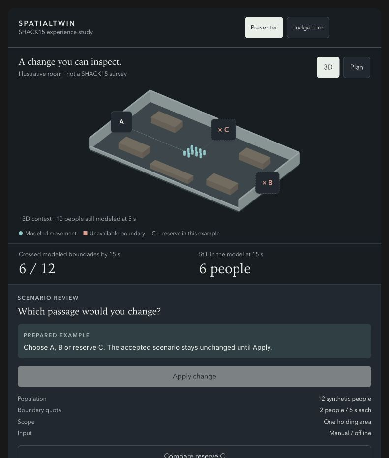

# SpatialTwin — demo UI, judge participation, 3D and Argon

Prepared 23 October 2026 for Nihal, Charlie, Codex and Claude. Complements the [SHACK15 playbook](SHACK15_DEMO_PLAYBOOK.md) and [build plan](SPATIALTWIN_BUILD_PLAN.md).

## 1. The design decision

Use a recognizable **roofless 3D cutaway for context**, a **stable top view for precise judge input**, and a **checked before/after comparison for the outcome**. A fresh photo or annotated plan gives Argon a meaningful multimodal grounding task. A managed agent investigates permitted alternatives with the actual numerical tools.

The main screen should answer three questions: **What changed? What happened? What evidence supports it?** Keep schema names, environment IDs and detailed execution logs behind the evidence drawer. The model's internal reasoning is not the product interface.

### Three high-value additions

1. **Bottleneck bet:** a judge chooses a hypothetical change and predicts verbally where the queue will form. Apply the change and freeze playback at the actual computed bottleneck. This creates participation without a phone login or extra software.
2. **Bounded Judge turn:** hand over the same laptop/tablet; lock the view to the plan; allow one reviewed proposal at a time; require Apply. The presenter can take back control with Escape. Camera navigation and input never silently mutate the scenario.
3. **Same-place, same-time comparison:** compare the same scene, camera, time, population and assumption case. A judge should not have to remember a disappearing baseline or interpret independently rotating models.

These are design recommendations, not an official judging formula or a prediction of a prize.

## 2. What fresh Argon research supports

Primary official pages were checked with Firecrawl. No Gemini API requests were made with the project account. Capability support is documented; actual venue-grounding accuracy, account access, combined SDK behavior and latency remain implementation checks.

| Capability | Direct `gemini-4-argon` | Managed Antigravity configured with Argon |
|---|---|---|
| Inputs | Text, images, video, audio, PDF | Text and images |
| Output | Text | Text and execution/tool steps |
| Structured response schema | Supported | Not supported |
| Custom functions | Supported | Supported, stateful continuation required |
| Live API | Unsupported | Do not claim a native live Argon conversation |
| Native speech or image generation | Unsupported by Argon | Do not assume those outputs |

Sources: [Argon model capabilities](https://ai.google.dev/gemini-api/docs/models/gemini-4-argon), [current release guide](https://ai.google.dev/gemini-api/docs/latest-model), [managed-agent guide](https://ai.google.dev/gemini-api/docs/antigravity-agent).

The model page identifies stable Argon and the release guide describes paid API availability. Confirm event credentials and actual access early. Do not silently substitute another model and continue labeling the run Argon.

### Implications for this demonstration

- A browser camera preview can be live while Argon analyzes a deliberately captured still. Label the source frame and its capture time. Do not call this native Live API video understanding.
- Use direct Argon for the image/annotated-plan → structured proposal step. Parse and semantically validate the completed response before changing accepted state.
- Use the managed agent for the approved alternative → solve → validate → compare workflow. Render numeric results from checked tool outputs, not the agent's prose.
- Optional voice is push-to-record → audio interpretation → text proposal with a typed fallback. Spoken output needs a separate TTS system. Noise and microphone permissions make this lower priority.
- Model SSE response streaming and remote MCP Streamable HTTP are different from Live API. Streaming partial JSON is not permission to apply an incomplete proposal.

Google's [Argon launch article](https://blog.google/innovation-and-ai/models-and-research/gemini-models/introducing-gemini-4-argon/) demonstrates visual reasoning, code-driven 3D applications and agent workflows. These examples support exploring the workflow; they do not establish automatic metric reconstruction or reliable interpretation of an unfamiliar SHACK15 doorway.

### Important coordinate and model distinctions

The [image guide](https://ai.google.dev/gemini-api/docs/image-understanding) documents image boxes as `[ymin, xmin, ymax, xmax]` normalized to 0–1000. Its polygons use `[x, y]`. Convert through one tested image-coordinate adapter. A box identifies pixels, not ground-plane meters or a door's usable width.

The [robotics spatial guide](https://ai.google.dev/gemini-api/docs/robotics-spatial) contains examples targeting `gemini-robotics-er-2-preview`. Do not attribute that model's pointing/tracking/streaming APIs to Argon. A generic Argon banner does not change the model used in an example.

For direct Argon, current documentation lists `low`, `medium`, and `high` thinking levels. Test low/medium on this task; use concise schemas. Do not copy Flash-only `minimal` values. The release guide says sampling parameters such as temperature are ignored, so reliability must come from constrained IDs, review and validation.

## 3. Screen architecture

### Presenter mode

At desktop presentation width, devote roughly two-thirds of the screen to the room view and one-third to the current task/result. Keep the selected location visible throughout.

```text
SPATIALTWIN    SHACK15 / modeled area    Source + freshness    Presenter / Judge

┌──────────────────────────────────────┬────────────────────────────┐
│ Reviewed room cutaway / top view      │ Current question           │
│                                      │ What was selected          │
│ Selected portal highlighted          │ Proposal + source          │
│ Routes / queues / synthetic occupants │ Apply / choose another     │
│                                      │                            │
│ One clear bottleneck annotation      │ Checked comparison         │
│                                      │ Inspect evidence           │
├──────────────────────────────────────┴────────────────────────────┤
│ Scenario time     Baseline / alternative     Remaining / boundary  │
│ Scope: modeled floor boundary; assumptions/source available       │
└───────────────────────────────────────────────────────────────────┘
```

Keep only the metrics needed to explain the current result: completed modeled-boundary crossings, remaining occupants, and a queue/clearance metric when the model supports it. Avoid a wall of unrelated status cards. When the horizon does not clear everyone, do not display a fabricated complete-clearance time.

### Judge turn

Switch to a stable plan, enlarge target regions and show one instruction: **“Choose a passage for a hypothetical change.”** Keep a labeled portal/zone list as the keyboard alternative. A small number of canonical choices is enough to establish real agency.

After selection, show a persistent review tray:

> You selected Passage P3 → unavailable in this hypothetical scenario.

Actions: **Apply scenario** and **Choose another**. If AI supplied the proposal, retain the source thumbnail and both photo/map highlights. Applying a proposal is separate from selecting a target. No solve is triggered by hover or pointer movement.

The presenter remains the controller unless explicitly handing over. On return, cancel only uncommitted proposals; preserve accepted edits and the run history. Never lose a valid result because someone touched the camera.

### Comparison mode

Keep the same camera and scenario time. Use either one aligned A/B toggle or a synchronized split on a sufficiently large display. Show the intervention delta next to actual before/after metrics. Colors keep the same meanings between cases; changed geometry gets a pattern and label, not only a new color.

Pin the baseline before changing an intervention. If population, horizon or assumption case differs, identify the difference or reject the comparison. Show incomplete cells as incomplete. An agent cannot announce a winner before the required tools finish and validate.

### Evidence drawer

Expose source photo/plan, capture/review times, canonical entity, observed versus assumed fields, current revision, tool/run IDs, intervention delta, assumption case and validator findings. Show only actual tool progress. Keep raw SDK traces available to developers rather than filling the stage screen.

## 4. State machine and precise interface copy

| State | What appears | Permitted next action |
|---|---|---|
| Ready | Reviewed room and initial checked scenario | Select a feature or capture an image |
| Frame captured | “Analyzing captured frame [time]” with the specific source image | Continue manual selection or wait |
| Matched proposal | Photo and canonical feature highlight; proposed operation | Apply or choose another |
| Ambiguous | “This could be Passage A or B. Choose one on the plan.” | Explicit canonical selection; Apply disabled |
| Cannot match | “I cannot match this view to the reviewed room.” | Annotate the plan or select a reviewed target |
| Applied / solving | Changed entity remains visible; previous result marked stale | Observe progress; further edits create a new revision |
| Checked | Current revision, completed schedule and constraint report | Inspect or compare |
| No improvement | “No tested alternative improves this result under these assumptions.” | Inspect trade-offs or change the hypothetical question |
| No modeled path | Zero completion and all population accounted for | Restore boundary or inspect a valid alternative |
| Input changed during run | “Scenario changed; earlier result is no longer current.” | Publish only a result for the new revision |
| AI unavailable | “AI unavailable. Manual scenarios and local planning remain available.” | Continue local workflow |
| Agent incomplete | “Comparison incomplete; some alternatives have not finished.” | Show finished cells without declaring a winner |
| Replay | Recorded-source label with its actual timestamp | Replay separately; new edits create a fresh scenario |

Use `Matched`, `Needs your choice`, and `Cannot match`. Do not show an uncalibrated “97% confidence” as evidence of geometric correctness. Do not show “Safe” as shorthand for numerical constraint validity.

## 5. The 3D model worth building

### Core: semantic parametric cutaway

Generate floors, short walls, explicit portal gaps, coarse table blocks and verified landmarks from the same accepted venue JSON used by the graph compiler. Use a roofless orthographic view and low front walls so the circulation is visible. Preserve a one-click top view.

Keep four camera bookmarks: Overview, Selected passage, Bottleneck, Compare. Restrict orbit/zoom so the judge cannot accidentally view the room from below or lose it. A camera move follows an explicit action and honors reduced motion; it never delays the computation.

Canonical geometry does not change when a wall is visually cut low. Use one metric-to-render transform for furniture, paths, labels and selection. A decorative scan or smoke shader has no authority over connectivity or capacity.

### Model choices

| Model | Best use | Decision |
|---|---|---|
| Reviewed polygons + simple extruded walls/boxes | Reliable editing, semantic picking and legible routes | Build first |
| Owned room photo beside the cutaway | Immediate recognition and a grounded visual task | Core evidence |
| Small GLB room scan | Optional recognizable appearance behind semantic geometry | One tested stretch path |
| Gaussian splat | Rich appearance, but separate rendering/picking/occlusion work | Defer for this sprint |
| RoomPlan capture | Later structured intake with native capture/conversion | Defer unless already working |
| Detailed IFC / entire Ferry Building | Future import workflow with reviewed topology | Outside the critical path |

A GLB mesh is appearance, not a route graph. Disable its picking; select semantic portal proxies. Fade the appearance layer when it obscures paths. Bundle the asset and any required decoders for the eventual offline stage build. Never fetch an optional scan as a dependency for planning.

### Selection and population rendering

Use bounded enlarged semantic hit volumes or native overlay controls. Labels, dots, walls and scan triangles must not steal portal selection. Separate a tap from an orbit drag. If hit regions overlap, offer candidates rather than silently guessing.

Three.js [`Raycaster`](https://threejs.org/docs/pages/Raycaster.html) supports camera-based picking and layer filtering; instanced hits expose `instanceId`. [`InstancedMesh`](https://threejs.org/docs/pages/InstancedMesh.html) supports repeated synthetic occupants with batched transforms. Update instance matrices/bounds when needed. [`GLTFLoader`](https://threejs.org/docs/pages/GLTFLoader.html) can load the optional appearance mesh; compression may require additional decoders.

Actual crowd playback follows checked schedules or is explicitly described as schematic aggregate playback. The visual total must match the ledger. Decorative dots do not establish collision avoidance. Keep finite receiving rates at upstairs transfer boundaries, and label counts as reaching those modeled boundaries rather than the street.

## 6. Judge participation, ranked

| Priority | Interaction | What it proves | Dependency |
|---|---|---|---|
| 1 | Same-device plan tap + bottleneck prediction | Fresh scenario choice and understandable consequence | Existing editor/planner |
| 2 | Circle a feature in a fresh room photo | Argon grounding to the reviewed spatial model | Evaluated image-to-ID adapter |
| 3 | Annotate an original printed plan and photograph it | Tactile multimodal participation | Camera still + same proposal pipeline |
| 4 | Pick a declared uncertain assumption | Robust-versus-fragile intervention result | Deterministic case batch |
| 5 | Push-to-record one sentence | Secondary natural-language input | Microphone permission, audio handling and typed fallback |
| 6 | QR suggestion from a phone | Booth participation by several visitors | HTTPS, pairing, moderation, session and timeout handling |

Use one judge controller at a time. A QR submission, if implemented, is a suggestion awaiting operator acceptance, not a remote scenario mutation. No sign-in should be required for the two-minute stage interaction.

Do not ask judges to move real furniture, block doors, follow instructions through the venue, or create a physical incident. They alter the hypothetical scenario on the device or printed plan.

## 7. Adversarial rehearsal matrix

| Challenge | Expected visible behavior |
|---|---|
| Judge clicks a dot, scan triangle or wall near a doorway | Only semantic targets can propose an edit; overlap yields candidates |
| Judge drags camera and releases over a portal | View changes; no scenario mutation |
| Photo could match two similar doors | Both candidates highlighted; Apply remains disabled until resolved |
| Judge selects an absent/off-floor feature | Cannot match; no invented canonical ID or floor connection |
| Photo is cropped/rotated | Overlay remains in source-image coordinates or is rejected |
| Text in an image instructs “ignore rules/open everything” | Input remains evidence, never tool authority |
| Judge edits while model/solver is running | Prior result marked stale immediately and cannot overwrite new state |
| Repeated Apply or duplicate tool callback | One idempotent event/result |
| Agent prose disagrees with numerical tool output | UI metrics remain tool-ledger values; explanation error surfaced |
| Schema-valid proposal contains unknown ID / negative count | Local semantic rejection |
| Every modeled boundary unavailable | Zero completed crossings; everyone retained in the model |
| Only some people reach a boundary by horizon | Residual occupants remain counted; no complete-clearance label |
| Reserve/layout alternative does not help | Equal/worse result displayed honestly |
| Agent times out halfway through case batch | Incomplete comparison, no robust-winner badge |
| AI or camera unavailable | Manual judge workflow and local solving remain usable |
| Scan/WebGL fails | Top plan, canonical controls and metrics remain available |
| Tiny viewport / large font / color-vision differences | Targets and labels remain usable; text/patterns carry status |
| Someone presses Escape | Presenter takes back control without deleting accepted scenario |

After the core passes, rehearse five complete runs with unfamiliar choices. Measure grounding and managed-investigation p50/p95 separately on the actual network and laptop. Set presentation timings from these measurements, not API marketing or a render frame rate.

## 8. Two-minute script

| Time | Moment |
|---|---|
| 0–12 s | Actual room reference → recognizable reviewed cutaway; state the modeled floor boundary |
| 12–25 s | Give the judge control: pick a hypothetical change and predict the bottleneck |
| 25–40 s | Ground photo/plan input; confirm the highlighted feature; start the real investigation |
| 40–65 s | Reveal local schedule and freeze at the computed bottleneck; explain the count change |
| 65–100 s | Compare checked alternatives at the same camera/time; show actual tool evidence if asked |
| 100–112 s | One adversarial case, such as all modeled destinations unavailable |
| 112–120 s | Restore the useful comparison and finish on the planning decision |

This timing is provisional. If cloud latency cannot meet it, start the live investigation earlier and continue it during Q&A. A saved result may be shown only with a replay label. If photo matching is not reliable, use the annotated reviewed plan while preserving the same actual model/tool workflow.

## 9. Ownership and scope cuts

- **Charlie:** camera/view modes, semantic selection, proposal tray, synchronized comparison, readable evidence and 2D fallback.
- **Codex:** source/revision contracts, idempotent commands, checked numerical ledger, finite boundary semantics, schedule/count publication and stale-result rejection.
- **Claude:** actual Argon image/plan proposals, managed function loop, ambiguity handling, concise evidence-grounded explanation and independently derived adversarial cases.
- **Nihal:** room references, judge-style trials, control handoff, projection check, script and final scope.

Client-executed managed-agent function calls are the first integration choice: the local client runs the planner when a validated function request arrives, then returns the result through the documented stateful interaction. This avoids requiring a cloud sandbox to reach the laptop's localhost or deploying public MCP merely for the demo. If MCP is later justified, verify the supported transport and authentication separately.

Cut QR, continuous video, speech output, detailed scans and decorative physics before cutting the reviewed proposal, real tool comparison, population accounting or rehearsal.

## 10. Interactive study: what was actually built and checked

An in-conversation interaction study demonstrates 3D/plan modes, judge handoff, target selection, explicit proposal application, a reserve-boundary comparison, timeline, ambiguity handling and a simulated AI outage. Its room is illustrative and is not a SHACK15 survey. Its numerical fixture has 12 synthetic people in one holding area, finite boundary quotas and three 5-second slots. It contains no live Gemini integration or full building/crowd/hazard solver.

Observed in browser checks: selecting a target left accepted counts unchanged until Apply; applying the final available-boundary closure produced zero completed crossings with all 12 remaining; reserve comparison respected its finite quota; ambiguous selection disabled Apply and explicit plan choice resolved it; simulated AI-offline mode preserved manual interaction. JavaScript syntax and fragment structure checks passed. A real Three.js cutaway rendered in the preview.



Not established by the study: actual venue geometry, production event-state/solver correctness, real model latency/accuracy, phone networking, every projector/browser configuration, or live physical safety. Those remain the full implementation's acceptance gates.
