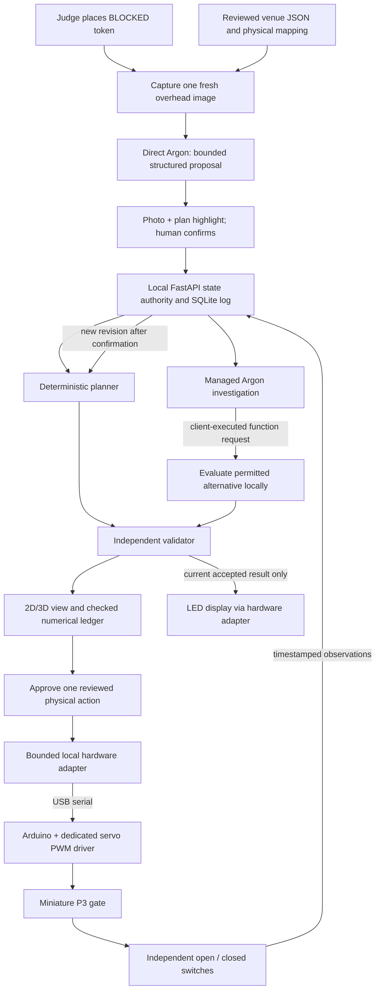

# SpatialTwin — physical SHACK15 demo build plan

Prepared 23 October 2026 for **Nihal, Charlie, Codex and Claude**. Prices are USD, US sourcing, before tax and shipping unless stated. Product prices and availability are observations, not reservations or delivery promises. The event duration and build rules still determine which preparation may happen beforehand.

## 1. The thing we are building

Build a small tangible scenario workbench: an original printed floor plan on a **24 × 18 inch / 609.6 × 457.2 mm** base, three illuminated modeled connections, one servo-operated miniature gate, two gate-position switches, one judge token, one fixed overhead camera, and the local SpatialTwin application.

The flagship loop is **judge places a blockage token → capture and interpret a fresh image → confirm the proposed change → compute and check the result → compare a permitted gate alternative → approve movement → independently confirm the gate position → recompute from confirmed state → update the physical lights and screen**.

The gate represents an **internal modeled connector**. Opening it does not create another exit or increase a floor-transfer boundary's receiving quota. Its benefit depends on the graph and constraints. An equal or worse alternative is a legitimate result.

Keep the prototype's synthetic occupants, hypothetical blockage and declared capacities visibly separate from the actual room references. The one-floor model ends at finite-rate modeled transfer boundaries, not the street. The tabletop is the controlled physical system; no building hardware is connected.

### Scope we can finish

- One reviewed venue layout, approximately 6–10 zones, three illuminated connections, two finite-rate transfer boundaries, and three supported judge targets (`P1`, `P2`, `B2`).
- One positional servo and two endpoint switches. No fan, elevator or motorized people.
- 24 RGB LEDs: eight per modeled connection indicator. These are route/status indicators; animated dots do not represent measured people.
- One intentional camera capture per judge choice; no continuous model inference.
- One bounded alternative investigation and an independent numerical check.
- Manual plan selection, local solving and explicit hardware-disconnected states as fallbacks.

The existing UI study demonstrates interaction only. The actual hardware, complete planner, firmware and live model workflow have not been built or tested in this planning task.

## 2. Physical layout and fabrication

### Venue content and provenance

Nihal obtains a shareable current event-layout plan or makes an original simplified drawing from permitted observations and checked dimensions. Review connections and the modeled area's boundaries. The public Ferry Building marketplace map is a different floor and cannot supply SHACK15 geometry. No verified current SHACK15 blueprint was found in the earlier research.

If the actual layout cannot be reviewed in time, present the board as an **illustrative scenario inspired by the venue**, alongside a permitted room reference. Do not label a fabricated fixture as a measured SHACK15 floor plan.

### Board construction

1. Cut a 20 × 30 inch foam board to **24 × 18 inches**. Use perimeter supports/standoffs with roughly **35–40 mm underside clearance**, checking the actual servo, connectors and cable bends. A thin second foam-board sheet alone does not provide that clearance. Keep the control electronics on a removable tray rather than burying them in glue.
2. Reserve a 20 mm margin and a 70 mm front control/legend strip. Fit the reviewed plan within the remaining printable area. Print at **100% scale** and verify a 100 mm calibration bar with a ruler.
3. Use removable paper artwork. Raised walls should be about **15–20 mm tall**, enough to recognize rooms without hiding the plan from the overhead camera.
4. Print canonical zone and passage IDs on both the artwork and UI. Start with `P1`, `P2`, `P3`, and boundary labels `B1`, `B2`. Attach physical electronics by ID, never by an assumed left/right ordering.
5. Mount one eight-pixel stick near each passage's route indicator, with the printed line showing which connector it refers to. Keep printed token pads beside the passage and outside the light-emitting area.
6. Mount the servo at `P3`. Use a lightweight 40–60 mm foam/card arm attached to its supplied horn and screw. A simple vertical gate flag is sufficient. Keep wires and switch levers outside its sweep.
7. Mount independent open and closed endpoint switches so the gate reliably presses exactly one at each calibrated endpoint. Adjust mounts before changing angles. Do not make the servo stall against the switch or board.
8. Make a **flat 30–40 mm blockage token**, labeled BLOCKED with a distinct shape/symbol. Provide printed 45–50 mm target pads beside `P1`, `P2` and `B2`. `B2` supplies the deliberate no-improvement case. The stage interaction supports these declared choices; arbitrary placements produce a request to choose a target.
9. Secure the camera roughly 500–700 mm above the board, then set its height from the actual field of view. All corners, target labels and the gate must remain visible. Mark the tested mount position.
10. Add strain relief, labeled cable ends and a removable underside cover. Keep a spare token, servo horn screw and known-good USB data cable with the board.

Generate the printed plan, 2D/3D geometry and physical mapping from one canonical venue JSON. Board millimeters, image pixels and represented building meters are different coordinate spaces. A print scale or camera transform does not establish building measurements.

### Meaning of the lights

| Display | Meaning |
|---|---|
| Dim white | Neutral / capture-ready indicator |
| Amber with a matching UI label | Pending proposal, stale result or hardware uncertainty |
| Red plus printed blocked symbol | Confirmed hypothetical unavailable passage |
| Cyan directional sequence | Connection used by the current checked plan |
| Off with a visible disconnected label on screen | No current physical display claim |

Use the screen and printed legend as redundant labels; color alone is insufficient. Never show the route through `P3` as an observed-state route while gate-open confirmation is missing. An alternative preview belongs on the screen and is labeled hypothetical.

## 3. Parts and budget

Buy the following baseline. Quantities are purchase quantities, including whole packs; do not count one resistor as a whole pack in the budget. **Electronics total: $148.99**, comprising $130.99 in sourced component prices and $18 in clearly labeled generic consumables allowances. This is before tax and shipping. The [CSV](PHYSICAL_DEMO_BOM.csv) contains the complete itemized list and options.

| Exact part | Buy | Unit / pack USD | Extended USD | Purpose |
|---|---:|---:|---:|---|
| [Arduino UNO R4 Minima ABX00080](https://store-usa.arduino.cc/products/uno-r4-minima) | 1 | 20.00 | 20.00 | 5 V logic, USB-C serial |
| [Adafruit PCA9685 breakout 815, DigiKey](https://www.digikey.com/en/products/detail/adafruit-industries-llc/815/4990757) | 1 | 14.95 | 14.95 | Independent servo PWM |
| [Adafruit RGB NeoPixel Stick 1426, eight pixels](https://www.adafruit.com/product/1426) | 3 | 5.95 | 17.85 | P1/P2/P3 indicators, 24 pixels total |
| [Adafruit SG92R positional microservo 169](https://www.adafruit.com/product/169) | 1 | 5.95 | 5.95 | One lightweight miniature gate; horns/screw included |
| [Adafruit wire-lever microswitch 820](https://www.adafruit.com/product/820) | 2 | 2.95 | 5.90 | Independent open and closed endpoints |
| [Adafruit 0.25-inch quick-connect harness 3838](https://www.adafruit.com/product/3838) | 1 ten-pack | 4.95 | 4.95 | Switch terminals to two-pin JST sockets |
| [Adafruit 5 V / 4 A regulated supply 1466](https://www.adafruit.com/product/1466) | 1 | 14.95 | 14.95 | Servo and LED load supply |
| [Adafruit female 2.1 mm jack adapter 368](https://www.adafruit.com/product/368) | 1 | 2.00 | 2.00 | Mates with center-positive supply plug |
| [Adafruit DF-15 1-to-5 distribution block 5616](https://www.adafruit.com/product/5616) | 2 | 1.95 | 3.90 | Separate load +5 V and common ground distribution |
| [Adafruit F/M jumpers 1954, twenty × 6 inch](https://www.adafruit.com/product/1954) | 1 pack | 1.95 | 1.95 | Logic connections |
| [Adafruit M/M jumpers 1956, twenty × 3 inch](https://www.adafruit.com/product/1956) | 1 pack | 1.95 | 1.95 | JST switch socket to UNO female header adaptation |
| [Adafruit 22 AWG stranded wire set 3111](https://www.adafruit.com/product/3111) | 1 six-color set | 19.95 | 19.95 | Short load branches and signal harness |
| [Adafruit 2.2 kΩ resistors 2782](https://www.adafruit.com/product/2782) | 1 25-pack | 0.75 | 0.75 | PCA OE boot-inhibit pull-up |
| [Adafruit 10 kΩ resistors 2784](https://www.adafruit.com/product/2784) | 1 25-pack | 0.75 | 0.75 | Servo-signal pull-down / spares; see final wiring |
| [Yageo CFR-25JR-52-470R, 470 Ω ¼ W](https://www.digikey.com/en/products/detail/yageo/CFR-25JR-52-470R/18092000) | 10 | 0.036 at ten | 0.36 | One NeoPixel DIN series resistor; nine spares |
| [Rubycon 10ZLH1000MEFC8X16, 1000 µF / 10 V](https://www.digikey.com/en/products/detail/rubycon/10ZLH1000MEFC8X16/3563430) | 1 | 0.60 | 0.60 | LED bulk capacitor |
| [Panasonic EEU-FR1A471, 470 µF / 10 V](https://www.digikey.com/en/products/detail/panasonic-electronic-components/EEU-FR1A471/9921021) | 1 | 0.71 | 0.71 | Local servo-rail capacitor |
| [Bulgin FX0380/BK, inline 5 × 20 mm fuse holder](https://www.digikey.com/en/products/detail/bulgin/FX0380-BK/9598435) | 1 | 9.16 | 9.16 | Enclosed screw-terminal load-feed fuse holder |
| [Schurter 0034.2521, 3.15 A M medium-time-lag, 5 × 20 mm](https://www.digikey.com/en/products/detail/schurter-inc/0034-2521/640091) | 2 | 2.18 | 4.36 | One installed, one spare; explicitly rated 125 VDC |
| 20 AWG stranded copper feed wire, about 1 m red + 1 m black | 1 allowance | 5.00 | 5.00 | Short PSU-to-distribution feed |
| Small perfboard, insulated standoffs and strain-relief hardware | 1 allowance | 4.00 | 4.00 | Permanently secured logic/passive joints |
| Heat-shrink assortment | 1 allowance | 4.00 | 4.00 | Insulate soldered joints |
| USB data cable, C-to-C or A-to-C to suit laptop | 1 allowance | 5.00 | 5.00 | UNO connection; check actual laptop ports |

**Stock caveat:** the exact PCA board was out of stock at Adafruit direct but available at DigiKey when checked. The quoted stock is not reserved. A shield or clone is not a drop-in replacement for the pin/OE schematic. Confirm arrival before purchasing the rest around it. The switch's product name “w/Wire” describes its lever; it does not mean electrical leads are attached. This build requires soldering.

### Total project budget

| Category | USD | Basis |
|---|---:|---|
| Electronics above | 148.99 | Includes $18 generic allowances |
| Recommended spare servo + spare stick + third distribution block | 13.85 | $5.95 + $5.95 + $1.95 |
| Foam board, wall strips and gate material | 15.00 | Planning allowance |
| Full-size print | 10.00 | Planning allowance; get a local quote |
| Tokens, adhesive and fasteners | 5.00 | Planning allowance |
| Argon testing/rehearsal allowance | 25.00 | Usage-dependent; see §9 |
| Subtotal with spares | **217.84** | Before tax/shipping |
| Tax/shipping reserve | 60.00 | Planning reserve, not a quote |
| Suggested available budget | **about $280** | Owned laptop; borrowed camera, mount and tools |

If buying a camera, [Logitech C920s](https://www.logitech.com/en-us/shop/p/c920s-pro-hd-webcam) was $59.99 on sale ($69.99 list) when checked, with 1080p/30 fps and a 78° diagonal view. Test full-board coverage and actual mounting; do not confuse diagonal field of view with horizontal. Budget an additional $35 for a suitable rigid mount, $80 for tools if none can be borrowed, and $20 for a hub if required. Those last three are allowances. Buying those extras raises the planning envelope to roughly **$475–$500**, with delivery/tax still variable. Reuse/borrow them where practical.

Charlie needs a soldering iron and stand, solder/flux, wire stripper, side cutters, small screwdriver, multimeter, ruler, craft knife/cutting surface and an appropriate heat-shrink tool. A camera/phone, mount and the laptop are required resources even when their additional acquisition cost is zero. Freeze these actual choices in hour one.

### Exact wiring overview

The [full wiring guide](PHYSICAL_DEMO_WIRING.md) includes the power diagram, sensor truth table, calibration, initialization and bench checks. Use its matched hardware rather than a visually similar board.

| UNO / supply connection | Destination |
|---|---|
| Laptop USB data cable | UNO USB-C; logic power and serial |
| UNO 5 V | PCA **VCC** only; also 2.2 kΩ OE pull-up source |
| UNO GND | Common negative distribution and PCA GND |
| A4/SDA, A5/SCL | PCA SDA, SCL respectively |
| D6 → **470 Ω** series resistor | First stick DIN |
| D7 | PCA OE; **2.2 kΩ to UNO 5 V** |
| D2, D3 | OPEN and CLOSED switches' NO; both switch COM → GND; NC unused |
| External regulated +5 V through load fuse | Load positive distribution → all stick +5 V and PCA **V+** |
| External supply negative | Common GND network |
| PCA channel 0 PWM / V+ / GND | Servo signal / red / brown-or-black, verifying actual lead labels |
| Stick A DOUT → B DIN → B DOUT → C DIN | One 24-pixel chain; C DOUT unused |

Add 1000 µF / 10 V across LED load power at the first stick, and 470 µF / 10 V at PCA V+/GND. Electrolytic stripe goes to negative. The two positive rails are deliberately separate: **never connect external load +5 V to UNO 5 V, VIN or PCA VCC.** LED/servo current goes through distribution, not UNO or a breadboard. Grounds intentionally join.

Add **10 kΩ from PCA channel 0 servo signal to GND** to bias the input low while the driver is unpowered/disabled. This reduces a floating signal; absence of startup twitch still needs a bench check. Use the specified **3.15 A M** fuse, not an assumed interchangeable 3 A T fuse. The holder and fuse have different ratings; both must fit the final DC application and measured inrush.

The PCA9685 removes the servo waveform from the MCU's LED-update timing. Do not use `Servo.h` in this architecture. At 24 RGB pixels, conservative full-white sizing is 1.44 A; add a provisional 1 A servo allowance and 0.10 A reserve, totaling **2.54 A** on the 4 A load supply. Actual servo peak and fuse behavior require measurement. Start brightness at about 25%; brightness is not the power-protection mechanism.

## 4. Software and AI connection



### Component responsibilities

| Component | Responsibility |
|---|---|
| React/TypeScript, Three.js or existing R3F UI | Judge handoff, source photo, stable plan selection, proposal review, synchronized comparison, hardware state |
| FastAPI + Pydantic | Single authority for commands, known IDs, source metadata, revisions, actuator authorization and result publication |
| SQLite | Observations, accepted commands, run inputs/hashes, model/tool calls and hardware acknowledgments |
| Bounded planner worker | Fixed capacity/time model and schedule; no model-generated code execution in the critical calculation |
| Independent checker | Population conservation, edge/node/boundary capacity, timing, unavailable connections and residual occupants |
| `pyserial` bridge | Owns one USB port, validates bounded protocol messages and associates board sessions with observations |
| Arduino firmware | Switch debouncing, permitted servo targets, LED frames, watchdog and status reporting |
| Direct Gemini adapter | Fresh image plus canonical catalog → completed, validated structured proposal |
| Managed-agent adapter | Bounded comparison of named alternatives using client-executed local tools |

Use local browser → local backend; do not add browser WebSerial, a public MCP server, a tunnel or hardware credentials to the cloud agent. Remote managed-agent code cannot reach the laptop's localhost. The local client receives a function request, runs the permitted tool, and sends back its checked result.

### Argon's exact role

Send a captured image, the reviewed plan/catalog, and the request: identify whether a BLOCKED token occupies one supported target and propose its canonical entity ID. Output fields should include `geometry_revision`, `capture_id`, `status` (`matched`, `ambiguous`, `no_match`), `candidate_ids`, nullable `entity_type` (`portal` or `boundary`), nullable `entity_id`, `operation` and a short visible-evidence description. Supported pairs are `(portal,P1)`, `(portal,P2)` and `(boundary,B2)`. Unknown IDs, wrong type/ID combinations, stale revisions, unsupported operations and ambiguous matches cannot be applied.

Show the photo and proposed passage or boundary together. The operator/judge confirms the match before accepting the hypothetical blockage. Reading printed target IDs is cooperative perception; do not describe it as uncalibrated exact 3D reconstruction. For a later free-placement mode, add tested planar calibration and footprint mapping as a separate feature.

Use **direct `gemini-4-argon`** for structured image interpretation. It supports image input and structured text output; native Live API is unsupported. For the managed comparison, use the documented Antigravity agent configured with Argon. Its text/image input and stateful function loop differ from the direct model; managed structured response schemas are unsupported. These are documented capabilities, not an executed integration in this deliverable. Sources: [Argon](https://ai.google.dev/gemini-api/docs/models/gemini-4-argon), [managed agent](https://ai.google.dev/gemini-api/docs/antigravity-agent).

The managed agent may request `evaluate_alternative` for a small enum such as `KEEP_CURRENT` and `OPEN_P3`, on an immutable accepted revision. It receives checked counts, bottlenecks, assumptions and run IDs. **It cannot send servo angles, write arbitrary firmware, create connections, or invoke physical actuation.** Actuation is a separate local approval command.

### Image capture discipline

Nihal asks the judge to lift their hand, then presses Capture. Freeze the current display or use the documented neutral capture state; never let an LED blink pattern become incident evidence. Send one chosen still, not an unbounded frame queue. A later response for an old capture/revision is discarded. Removing a token does not silently reset an accepted scenario; use an explicit reviewed Reset.

### State transitions that prevent a misleading demo

1. On startup, read the two switches. Exactly one stable endpoint establishes the initial gate state. Both pressed is a fault; neither pressed means intermediate/unknown.
2. Accept the judge's confirmed blockage into revision `r`. Mark the prior numerical plan and physical route display stale immediately. Solve and check `r`.
3. Evaluate `OPEN_P3` as a hypothetical delta from the same immutable revision and scenario start. Keep its result separate from observed state.
4. The judge approves the named gate action. Recheck revision, calibration, board session and actuator eligibility locally. Send one idempotent command.
5. While the gate moves, treat its modeled connector as unavailable. Independent switches may report a transient unknown position. No successful open claim follows from an acknowledgment alone.
6. After a stable open observation for the current board session, create a new accepted revision with the observed gate state. Solve and check again before publishing physical route lights.
7. If movement times out, a contradictory switch state appears, the board disconnects or a newer scenario invalidates the action, show the fault/uncertainty. Do not publish the hypothetical improvement as achieved.

The simulator is a scenario workbench, not a running real-world evacuation clock. Before/after results restart from the same initial synthetic population and horizon. The sequence above does not account for people moving while a real gate is in transit. A later real-time system would need action duration and evolving occupancy in its planner.

### Minimal application contracts

Use line-delimited JSON for the small serial messages. Proposed protocol version `1`; `boot_id` changes on every firmware start, and `seq` increases within a boot. Use `session_id` or a handshake nonce so delayed host commands from an earlier connection cannot execute after reconnect.

Host commands: `HELLO`, `HEARTBEAT`, `READ_STATE`, `ARM`, `SET_GATE_TARGET` (`OPEN`/`CLOSED` only), `SET_DISPLAY`, and `STOP_OUTPUTS`. Firmware messages: `HELLO_ACK`, `ACK`, `OBSERVATION`, `FAULT`. Record `command_id`, `expected_boot_id`, `expected_gate_epoch`, `scenario_revision` and `calibration_id` with an action. Repeated command IDs return their prior status without restarting motion. Firmware owns calibrated endpoint pulses; no raw angle supplied by Argon or browser reaches it. `ARM` requires a current handshake, heartbeat, inspected/calibrated mechanism and one valid stable endpoint; it does not move the gate. Re-arming after a fault is explicit.

Use `v: 1` as the serialized protocol-version field. For example, the proposed move envelope is:

```json
{"v":1,"type":"SET_GATE_TARGET","session_id":"host-session-1","command_id":"move-001","expected_boot_id":"boot-1","expected_gate_epoch":4,"scenario_revision":12,"calibration_id":"gate-cal-1","gate_id":"G1","target":"OPEN"}
```

An `ACK` means accepted, not arrived. An `OBSERVATION` contains `boot_id`, increasing `seq`, `gate_epoch`, `gate_id`, `state`, `open_switch`, `closed_switch`, optional related `command_id`, and `fault`. The main schema above is the canonical naming contract; implementation freezes the remaining field sizes in hour one. Only a fresh observation can establish an endpoint.

Keep the full event/ledger on the laptop. Firmware uses bounded buffers and a compact parser, rejects oversized/invalid frames, validates command types and discards commands for another session. Do not put images or solver schedules on the serial link. Send the 24-pixel display as a small bounded payload at no more than 10 updates/second, and rate-limit in both bridge and firmware.

Suggested repository modules, to be created during the authorized build period:

```text
frontend/                    # React UI
backend/app/state/           # commands, snapshots, SQLite ledger
backend/app/planner/         # immutable solver and independent checker
backend/app/ai/               # direct Argon + managed function loop
backend/app/hardware/         # serial session, display projection, action approval
firmware/spatialtwin_board/   # Arduino sketch and pinned library manifest
venue/                       # reviewed geometry, provenance, device mapping
tools/export_board.py         # canonical JSON → original printable artwork
tests/fixtures/              # illustrative cases and recorded protocol messages
```

Do not treat these proposed folders or protocol messages as existing implementation or vendor APIs.

## 5. Four-contributor split

There are **two physical builders**. Codex and Claude can write code, generate artwork, inspect documentation and review results; Nihal and Charlie must purchase, solder, cut, measure, upload and operate the hardware.

| Owner | Owns | Concrete deliverable | Needs from others |
|---|---|---|---|
| **Nihal** | Procurement, venue references, artboard approval, camera framing, judge testing and presentation | Parts in hand; original reviewed layout; full-size mounted print; 20 fresh labeled captures; two-minute narrative | Codex export tool; Charlie's mount/mechanism footprint |
| **Charlie** | Power/harness, soldering, gate mechanism, endpoint sensing, physical assembly and spares | Meter-checked wiring; calibrated gate; 30 repeatable cycles; fixed camera; documented reset | Codex firmware/protocol; Nihal artwork and physical tools |
| **Codex** | Backend authority, fixed-graph planner and independent checker, firmware, serial bridge, UI shell and integration | Manual edit → checked result → matching LEDs; approved movement → switch observation → fresh solve | Charlie's real board tests; Claude's bounded proposal/tool interfaces |
| **Claude** | Argon image proposals, managed tool investigation, source/review/evidence UI component, adversarial cases | Fresh photo → reviewed canonical match; actual checked alternative calls; ambiguity, latency and offline behavior | Codex schemas and numerical tools; Nihal captures and account access |

Agree on the small scenario, proposal, run-result and serial schemas in the first hour. Codex owns shared backend/UI state files; Claude owns an isolated proposal/evidence component and AI adapter. Neither silently edits the other's interface. Charlie sends measured observations, serial logs and calibration values; the AI collaborators must not mark a physical test passed without those observations.

### Day-of build schedule

The earlier event research identifies a 13-hour event window. Use **10 hours of building, two hours of recovery/rehearsal, and one hour of submission/logistics**. These are elapsed work blocks, not a new event timetable. Parts must be in hand. Only perform preparation that the actual rules allow; do not assume advance project implementation is eligible.

| Elapsed | Nihal | Charlie | Codex | Claude | Exit condition |
|---|---|---|---|---|---|
| 0–1 h | Freeze reviewed layout, IDs and supplies | Inventory; isolated LED/servo/switch bench checks | Freeze schemas; manual UI and small graph | Confirm actual Argon/agent account access | No missing critical part; common contracts |
| 1–3 h | Print at 100%, measure scale, mount artwork | Solder PCA/LED harness; adjust gate mounts | Fixed-graph solver/checker; firmware handshake; artboard export | Fresh-image proposal and source/review component | **Hour 3: a real checked numerical result** |
| 3–5 h | Camera framing, labels, assembly support | Install mechanism and endpoint switches | USB action executor, switch-state revisions, LED projection | Integrate proposal review; actual managed tool client | **Hour 5: manual end-to-end hardware loop** |
| 5–7 h | Fresh unfamiliar token placements | Motion, USB and reset trials; fix mechanical issues | Re-solve after confirmed motion; stale-result handling | Actual alternative investigation; ambiguity/offline states | **Hour 7: freeze IDs and physical topology** |
| 7–9 h | Judge trials on the actual display | Cycle testing, cable labels and spares | Failure cases, local dependency packaging, clean-start check | Grounding errors, tool-result consistency, measured latency | Show useful and unhelpful interventions |
| 9–10 h | Record a labeled fallback; submission assets | Final assembly inspection | Blocking defects only | Independent adversarial run | Freeze features |
| 10–12 h | Five complete rehearsals | Repeatable physical resets | Recovery buffer | Account/network and explanation checks | Choose proven stage mode |
| 12–13 h | Submit and move/setup | Known-state reset, operator role | Support startup | Support startup | Logistics reserved |

**Hour-3 cut:** if the room-scale planner is not ready, narrow honestly to the finite-capacity fixture. **Hour-5 cut:** if motor/sensing is unreliable, keep the gate fixed and show a labeled predicted alternative; use a hand-operated sensed gate only if that variant is reliable. **Hour-7 cut:** if vision is unreliable, use direct plan selection and retain the actual tool investigation. None of these cuts justify fake endpoint confirmation or invented numerical results.

If 24–36 hours are genuinely available, use the extra time for grounding trials, model fidelity, zone/capacity validation and mechanical reliability. Do not spend it on more motors before these checks pass.

## 6. Assembly and integration order

1. **Inventory first:** match exact board, RGB LED variant, servo plug, power connector and all supplied headers. Confirm a soldering station, multimeter and USB data cable are physically available.
2. **Unpowered harness:** solder, insulate and label the PCA, three sticks and switch adapters. Meter external positive versus USB positive to confirm separation. Check common ground and capacitor polarity.
3. **Logic and pixels:** compile a minimal UNO R4 sketch; identify its USB port; exercise one LED, then chase all 24 indices. Label actual stick ordering A/P1, B/P2, C/P3.
4. **PWM driver:** verify I2C address `0x40`, OE inhibition and PCA-only channel 0 pulse control, with the horn initially removed. Calibrate a small travel range, then fit the lightweight mechanism.
5. **Sensors:** identify COM/NO/NC with the meter. Verify each endpoint and the two fault/unknown combinations. Record measured `open_us`/`closed_us`; do not copy generic 0°/180° limits.
6. **Local manual flow:** accept a manual P1/P2 passage closure or B2 boundary closure, run the fixed graph, validate, and derive LEDs from that exact result ID. This must work before cloud integration.
7. **Actuation flow:** evaluate predicted OPEN_P3; approve; receive ACK; wait for independent endpoint; increment physical revision; solve/check/publish. Exercise a missing endpoint before celebrating success.
8. **Fresh image:** use neutral lights, stationary gate and clear hands. Capture → actual Argon response → local validation → highlighted review → accepted hypothetical edit. Compare manual and AI-grounded provenance.
9. **Managed investigation:** connect only allowed local numerical tools. Log actual interaction IDs, tool calls, run contexts and validator results. The cloud receives no serial port or arbitrary actuation tool.
10. **Package and rehearse:** pin successful board-core/library/SDK versions and lockfiles, store camera framing/calibration, cache local assets, and start from a clean power/application state five times.

## 7. Acceptance checks

| Check | Pass condition |
|---|---|
| Print and mapping | 100 mm ruler verifies print; P1/P2/P3 on paper, UI, graph and LED indices agree |
| Power and reset | Correct measured 5 V polarity; no USB/external positive bridge; boot/reset has no commanded sweep |
| Current and visibility | Measured peak load and fuse behavior acceptable; all 24 LEDs legible without obscuring token labels |
| Servo + LEDs | At least 30 complete open/close cycles with active light updates; no reset, sustained stall or cable snag |
| Switch logic | Open/closed independently confirmed; both active faults; neither active never means open |
| Failed motion | A non-arrival test times out without repeated movement; no observed-state benefit published |
| Duplicate command / Apply | One accepted state event and one physical action |
| USB disconnect / reboot | No automatic replay; old board session invalid; re-identify and rearm from actual switches |
| New judge change during AI/solve | Old response cannot repaint current screen or physical display |
| Camera capture | At least 20 fresh placements including rotation, occlusion, between-pad and multiple-token cases; correct proposal or visible abstention, with corrections recorded |
| AI outage | Manual canonical selection, checked local solving and hardware remain usable |
| Helpful alternative | P2 blocked in the illustrative topology can benefit from P3 under declared input assumptions |
| Unhelpful alternative | B2 unavailable cannot be recovered by opening P3; no celebratory improvement is fabricated |
| All boundaries unavailable | Zero completed crossings; all synthetic occupants remain counted |
| Population and capacity | Independent checker covers all occupants, wait/storage states, travel, passage throughput and finite boundary quotas |
| Evidence agreement | Screen and physical display use the same current checked result or explicitly show stale/capture mode |

The planner keeps every initial occupant in the finite-horizon model. Maximize completed boundary crossings first, then minimize schedule cost at that fixed maximum, retaining the rest. A permanent unavailable connection cannot reappear through a waiting edge. See the existing [build plan](SPATIALTWIN_BUILD_PLAN.md) for the full two-pass formulation and independent-validator requirements.

## 8. Two-minute presentation and recovery

| Time | Action |
|---|---|
| 0–12 s | Recognizable room reference, original tabletop schematic, modeled boundary scope |
| 12–25 s | Judge places a token and predicts a queue |
| 25–40 s | Capture, actual Argon proposal, highlight and confirmation |
| 40–60 s | Checked changed result; corresponding physical light state |
| 60–85 s | Actual agent tool investigation and predicted alternative |
| 85–105 s | Judge approves miniature action; movement, endpoint confirmation and new checked solve |
| 105–120 s | Same-time/same-population comparison, remaining count and evidence |

These intervals are provisional rehearsal targets. No model latency was measured in this planning work. Start the investigation as soon as accepted inputs exist; use measured latency to decide the final script. Do not display fake progress. If a live task needs longer, continue into Q&A. A saved run or video is labeled replay.

On stage, Nihal presents and handles the judge interaction. Charlie operates reset, watches mechanics and handles physical recovery. Codex/Claude support preparation and debugging; the two humans should be able to present without live coding.

The strongest booth challenge is: **“Find a blockage where opening the reserve does nothing.”** It exposes the real downstream constraint and makes the model's reasoning easier to inspect.

## 9. Argon and operating cost

The official [Gemini pricing page](https://ai.google.dev/gemini-api/docs/pricing#gemini-4-argon), checked 23 October 2026, lists standard Argon at **$2 per million input tokens and $10 per million output tokens including thinking through 30 November 2026**. It lists $4/$20 starting 1 December. Confirm rates if the event date changes. There is no Argon Free tier in the current model table.

An illustrative grounding request with 10,000 billed input tokens and 1,000 billed output/thinking tokens costs **$0.03** at the current standard rate; this is arithmetic, not measured image usage. Fifty such requests cost $1.50. Agent loops can consume substantially more tokens, including intermediate contexts. [Agent pricing](https://ai.google.dev/gemini-api/docs/pricing#pricing-for-agents) currently bills inference at standard model rates and does not bill environment compute during preview.

Reserve **$25 of API budget** for experiments and rehearsal, log actual usage, and use bounded local tools. The managed guide documents `agent_config.max_total_tokens`; start with a 20,000-token best-effort budget and only two named candidate alternatives. Test that budget against the actual SDK/workload. A token budget is not a latency guarantee or a hard invoice cap; stop incomplete comparisons without declaring a winner. No paid model requests were made for this plan.

Existing laptop, local libraries and a borrowed/owned camera have no additional acquisition cost in the base budget. Paid hosting, Firecrawl runtime calls, Wi-Fi hardware pairing and TTS are unnecessary for the core loop. Firecrawl was used for research, not as the route planner or motor controller.

## 10. Why this design survives skeptical questions

| Challenge | Demonstrable answer |
|---|---|
| “A prerecorded light show?” | Fresh judge-selected target; current input/run IDs; useful and unhelpful cases |
| “You invented another exit?” | P3 is an existing modeled internal connector; B1/B2 rates stay fixed |
| “The motor proves the plan worked?” | Predicted result, serial acknowledgment and independently confirmed state are distinct |
| “The AI is doing the arithmetic?” | AI grounds evidence and investigates; fixed tools compute; independent code checks |
| “Is that really SHACK15?” | Original reviewed sources and uncertain fields visible; illustrative fixture explicitly labeled |
| “The gate jams or the network fails?” | No observed opening claim; manual selection/local solving and labeled predictions persist |
| “Will four contributors finish?” | Two humans own physical tasks; AI owns bounded software modules; hour 3/5/7 cuts protect the core |

Do not add fans, smoke effects, additional motors, wireless sensors, room reconstruction, voice or QR until the complete checked loop and rehearsals pass.

## 11. Deliverables and present status

- [Pin-by-pin wiring and bench procedures](PHYSICAL_DEMO_WIRING.md).
- [Priced shopping list CSV](PHYSICAL_DEMO_BOM.csv).
- [Printable 24 × 18 inch board template](PHYSICAL_DEMO_BOARD_TEMPLATE.svg), with a [preview](PHYSICAL_DEMO_BOARD_PREVIEW.png).
- [Matching device-map fixture](PHYSICAL_DEMO_DEVICE_MAP.json). It intentionally has null servo endpoints and missing building metric/capacity values; it cannot be treated as valid solver input before calibration/review.
- Existing [UI/UX specification](DEMO_UI_UX_AND_ARGON.md), [venue playbook](SHACK15_DEMO_PLAYBOOK.md) and [main architecture](SPATIALTWIN_BUILD_PLAN.md).

The print preview was rendered and visually checked. Device-map JSON, LED-index allocation, document links and budget arithmetic are checked during artifact preparation. Hardware motion, actual current, live model access/latency and full numerical implementation remain build acceptance tasks.
