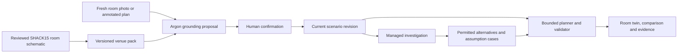

# SpatialTwin at SHACK15 — venue demo and competitive strategy

Prepared 23 October 2026. Nihal confirmed that the demo will run at **SHACK15**. This supplements the [build plan](SPATIALTWIN_BUILD_PLAN.md), [tool research](TOOL_SELECTION_AND_SOURCES.md), and [architecture review](ARCHITECTURE_REVIEW.md). The team remains Nihal, Charlie, Codex and Claude.

For the detailed screen/state design, participation ladder, 3D picking/camera rules, adversarial rehearsals and current Gemini capabilities, see [demo UI/UX and Argon](DEMO_UI_UX_AND_ARGON.md). The core judge interaction uses a captured still or marked plan; native Argon Live API is unsupported.

The new [physical tabletop build plan](PHYSICAL_DEMO_BUILD_PLAN.md) specifies the floor-plan/motor/lights version, including shopping list, pin map, position confirmation and event-day assignments. Its supplied printable template is an illustrative integration fixture pending replacement with a reviewed venue layout.

## 1. The recommendation

Make the flagship demonstration **“Stress-test the SHACK15 room we are standing in.”** Open with the recognizable Ferry Building, move into a small reviewed model of the actual event area, and let a judge introduce a new hypothetical change using a freshly captured room photo or an annotated plan.

Argon grounds that change in the model. A managed agent tests a small set of permitted simulated interventions with the deterministic planner and independent validator. The product shows the measured comparison, what assumptions it depends on, and what remains unresolved.

This can be memorable without an architectural model, whole-building reconstruction, or physical actuators. The winning moment is a judge recognizing their surroundings, choosing something unfamiliar, and inspecting a defensible result. No outcome or prize can be guaranteed.

**The central question:** “Which of these event-layout changes performs best under the assumptions we can actually support?”

**The strongest upgrade:** “Does that choice still help if the uncertain input changes—and what should we measure next?”

## 2. What the research establishes

| Source | Verified finding | How to use it |
|---|---|---|
| [SHACK15 About](https://www.shack15.com/about) | SHACK15 identifies its location as the Ferry Building's top floor and describes lounges, a cafe/bar and bay views | Establish venue context; use recognizable features verified in the actual room |
| [SHACK15 Private Events](https://www.shack15.com/events) | Public event photos and hackathon hosting; no floorplan link identified in the page read | Visual reference, not the current event's measured geometry |
| [Official Ferry Building map](https://www.ferrybuildingmarketplace.com/map/) | Legible marketplace graphic, with an asset filename labelled September 2026 | Lower-level marketplace context; not the SHACK15 event-room map |
| [Official visit information](https://www.ferrybuildingmarketplace.com/visit/) | Embarcadero/Market Street setting, public facilities and circulation descriptions | Exterior/context labels; no inference of approved emergency routes |
| [Ferry Building venue rentals](https://www.ferrybuildingmarketplace.com/venue-rental-events/) | Grand Hall, Port Hearing Room and plaza descriptions; public Matterport links | Background research for those distinct spaces, not proof of SHACK15 coverage |
| [Official hackathon page](https://cerebralvalley.ai/e/gemini-4-argon-sf) | Argon emphasis and Managed Agents prize; current public text names San Francisco without an exact room | Competitive fit; exact venue comes from Nihal's confirmation |

The marketplace graphic was visually inspected at 2560 × 1113. It shows the long concourse, merchants, plazas, stair/elevator icons and illustrated openings. It supplies no measured indoor scale, portal widths, capacities, approved emergency routes, or current upstairs event arrangement. Its filename is a revision label, not a survey date.

**No verified, current SHACK15 blueprint was identified in the public sources read.** Do not use the marketplace map or the Grand Hall tour as though either depicts the judging room. A small self-authored, human-reviewed room schematic is enough for the proposed demonstration.

The map page links [Hudson Pacific terms](https://www.hudsonpacificproperties.com/terms-and-conditions/) that restrict reproduction, display and derivatives without written permission. Prefer an original schematic based on permitted observations and measurements; if including the exact supplied artwork, obtain explicit permission covering the demonstration and any repository publication. Attribution alone is not an affirmative reuse grant. No third-party map or venue photograph is included as a redistributable asset in this deliverable.

## 3. Use three spatial layers with different purposes

### Layer A — recognizable context

A brief original Ferry Building silhouette or an owned photo establishes where we are. Label SHACK15 on the correct floor. The context view is orientation, not the computational evacuation model. A short visual zoom is sufficient; do not spend the sprint building San Francisco.

### Layer B — the actual modeled SHACK15 area

Model approximately 8–12 meaningful zones: presentation area, attendee/table blocks, a few reviewed aisles, fixed structural features, and staff-confirmed same-floor transfer boundaries. These names are placeholders until the actual room is checked. Avoid modeling every chair or the entire advertised SHACK15 space.

Use a current shareable event-layout plan if provided. Otherwise make an original simplified plan from permitted observations, a few checked dimensions and visible landmarks. Mark imported, observed, approximate and assumed properties separately. Keep uncertain connections unavailable pending review.

### Layer C — hypothetical scenario

Synthetic occupants, a declared incident, permitted layout alternatives and modeled service rates sit on top of that reviewed geometry. A current room photograph is live evidence; it does not make synthetic crowd numbers or hazard predictions live measurements.

These layers should be visible in the UI: **Venue/context → reviewed room model → simulated incident and population.**

## 4. The critical upstairs boundary

The original MVP is a one-floor model. For SHACK15, a route reaching a stair or transfer portal has not yet reached the street. Do not add an animated line down an unmodeled staircase and count the building as evacuated.

Use an explicit result such as **“Assigned to modeled floor-transfer boundaries by the scenario horizon.”** Show the exact scope boundary alongside the metric. Stair descent, lower floors and final discharge remain outside this demonstration unless modeled and validated separately.

Transfer boundaries must have **finite declared receiving/service rates**, and any in-scope waiting/holding capacity must be represented. They must not become hidden infinite sinks. Unknown downstream acceptance belongs in the displayed assumption range; it is not a measured stair capacity. If receiving quota is exhausted, the remaining people keep consuming modeled occupancy.

This boundary makes the demonstration both buildable and technically defensible. A later full-building version needs stair travel and occupancy, shared flows between floors, transfer timing and additional validation.

## 5. The flagship live interaction

### Fresh photograph → grounded proposal → checked comparison

1. Establish two or three reviewed landmarks in the modeled room, such as a distinctive structural feature, window boundary and visible portal. Choose features actually present and observable.
2. Capture a permitted, tightly framed photo from a new viewpoint. Alternatively photograph the judge's annotated original room plan.
3. Let the judge circle a doorway/zone and describe a hypothetical change: “Suppose this passage is unavailable.” No real passage changes state.
4. Send Argon the reviewed map with canonical IDs, reference crops and the new annotated photo. Ask for the matching portal/zone, source evidence and unresolved ambiguities.
5. Show the proposed match on both photo and map. The operator/judge confirms it; ambiguous matches highlight candidates rather than inventing certainty.
6. Accept the typed change into the versioned scenario. Start local replanning and the bounded managed-agent investigation.
7. Compare baseline and two eligible alternatives. Every result has the same initial population, horizon and hazard assumptions except for the named intervention.

This establishes new multimodal input and unfamiliar scenario selection while disclosing that the geometry was prepared and reviewed. It does not require a continuous video stream, camera pose estimation, SLAM, or automatic 3D reconstruction.

If a photo shows furniture, its floor footprint remains a proposed observation. A human confirms the footprint on the plan before it affects geometry. The image alone does not establish an aisle width or mechanical door state.

**Acceptance before committing to this interaction:** test at least five held-out views/annotations in the actual supported area. Record correct IDs, corrections and unresolved cases. An uncertain proposal must fail visibly with `needs_confirmation`. This is a proposed test gate, not an achieved accuracy claim.

**Reliable backup:** a judge marks the reviewed printed plan; a photo enters the same model-proposal pipeline. This still demonstrates genuine visual interpretation and does not require ArUco or homography unless automatic token positioning is specifically retained.

## 6. Ranked ways to improve the chance of winning

Impact/effort rankings are design judgments, not an official judging rubric. Prioritize the first four; the rest must earn their time.

| Priority | Addition | Competitive value | Build decision |
|---|---|---|---|
| 1 | Recognizable room photo → matching cutaway, with a confirmed You are here anchor | Immediate connection to the room and audience | Core; static photo-to-map switch is sufficient |
| 2 | Judge-selected change on a fresh photo or annotated plan | Tests real visual grounding and fresh inference | Core after a held-out trial; visible human confirmation |
| 3 | Real managed-agent intervention comparison | Gives the model useful investigative work and genuine tool evidence | Core flagship; local fallback remains available |
| 4 | Same scenario under three declared assumption cases | Reveals robust versus fragile conclusions | Best upgrade after the single-case workflow works |
| 5 | Clickable evidence for each important portal | Makes geometry and assumptions inspectable | Small metadata/UI addition |
| 6 | “What should we measure next?” | Turns uncertainty into a concrete next action | Add only when sensitivity results justify the answer |
| 7 | Independent second layout / real topology edit | Demonstrates that the app is not a venue-specific animation | Acceptance/Q&A proof using the same compiler |
| 8 | Reproducible incident receipt | Judge leaves with a clear technical artifact | One-page run export after core, no automatic sharing |
| 9 | Real venue-user feedback | Tests usefulness and gives a grounded product story | Brief voluntary staff conversation; quote only with permission |
| 10 | Small room scan as an appearance layer | Visual recognition without a physical model | One tested stretch path; never replace graph review |
| 11 | Audience QR controls | Participation from a phone | Skip unless network, access controls and core are stable |
| 12 | Whole-venue reconstruction, live crowd tracking or public alerts | Large implementation and evidence burden | Outside the sprint |

### The best new feature: uncertainty-aware comparison

Run the baseline and two reviewed alternatives under three cases of **one** uncertainty axis: either a common walking-speed multiplier or one declared boundary service-rate range. Apply the same case to every alternative. Do not silently change population or other assumptions to make an intervention look better.

The output is a small table: completed boundary crossings, remaining population, queue metric and validation status for each cell. Use actual results; there are no prewritten improvement percentages. An option can dominate across all cases, or its ranking can change. Both outcomes are useful.

The managed agent explains the computed evidence. It can identify the input that changes the ranking only if the sensitivity calculation actually supports that statement. Three tested cases are not a guarantee over every possible input; call the result best among the alternatives and cases tested.

Implement `compare_cases` as a deterministic application tool wrapping the existing run API. At most three alternatives × three cases means at most nine bounded local solves, not nine additional model calls. Each cell carries scenario, assumption and plan hashes. An incomplete batch cannot declare a robust winner. Keep worker concurrency bounded.

### The intervention catalog

Choose two meaningful alternatives after reviewing the actual layout. Examples are a different **simulated** temporary-table/queue footprint, use of an eligible additional same-floor boundary, or another declared corridor-direction arrangement. Do not invent a door, assume an unknown connection, or change a real door/furniture/sign for the presentation.

Distinguish changing layout from changing route choice: the baseline optimizer should already use available eligible paths. An “intervention” that merely enables a path the baseline silently ignored is an unfair comparison. Store intervention deltas and show them explicitly.

### The incident receipt

Offer a one-page local export containing the reviewed plan thumbnail, actual incident edit, source/observation time, model scope, tested alternatives, declared assumptions, measured results, validator summary and run ID. Let a reviewer reproduce the scenario. This makes the demonstration useful beyond the pitch; it must not look like an official venue emergency instruction.

## 7. The two-minute demo

Populate all metrics from the running application. The timing is a rehearsal target and depends on measured model/agent latency.

| Time | Action | Evidence |
|---|---|---|
| 0–10 s | Show a recognizable SHACK15 landmark photo, then the same area in the twin | Correct floor and reviewed model boundary |
| 10–20 s | State the user problem: facilities teams testing event layouts before a drill | Synthetic population and scenario clearly identified |
| 20–35 s | Judge circles a portal/zone on a fresh photo or plan and describes a hypothetical closure | Argon match, human confirmation, new scenario revision |
| 35–55 s | Show the local replanning result; begin agent work as soon as the new snapshot exists | Visible queue, boundary crossings, remaining count and checked schedule |
| 55–85 s | Agent tests two eligible changes with real tools | Readable snapshot → solve → validate → compare events |
| 85–105 s | Show the compared results; if ready, include the three assumption cases | Useful intervention or an honest ranking-dependent-on-input result |
| 105–115 s | Briefly make all modeled boundaries unavailable | Zero completed crossings; all people still accounted for |
| 115–120 s | Restore the useful checked comparison | End on the decision and the user benefit |

Suggested opening: **“This is the SHACK15 area around us. We made a reviewed spatial model so an event planner can test a layout change before a drill. You choose the hypothetical change.”**

Suggested closing: **“SpatialTwin connects a reviewed room plan, new visual evidence and checked scenario comparisons—so a planner can see what a decision depends on.”**

Do not narrate API names in the main pitch. Keep actual agent/model IDs, tool arguments and validator details in the evidence drawer for Q&A. During cloud work, show the timeline and the physical pinch point the audience can recognize.

If the agent cannot reliably complete in the allotted presentation window, use the live local update on stage and continue the live investigation during booth/Q&A. A saved result is a saved result, with a visible replay label. A good local demo and truthful network status are preferable to an unlabeled substitute.

## 8. Preparation and arrival runbook

### Before the event

- Ask for the current shareable SHACK15 event-room layout, confirmation of the modeled area, permitted image/map use, and presentation duration. Do not assume the marketing photos show today's chairs/partitions.
- Prepare the canonical blank room template, neutral portal IDs, source metadata, two intervention slots and synthetic occupancy presets.
- Finish a working end-to-end loop on an owned fixture before venue-specific polish. The backend/agent/UI interfaces must already agree.
- Prepare a local launch, bundled assets/fonts, a printed original plan, power/network fallback and a short labeled backup recording.
- If a scan is considered, test the exact device/export/import path before relying on it at the venue.
- Confirm permitted build preparation and submission rules with the organizer; the published event hours are not a complete build policy.

Copy-ready request for Nihal to use with the organizer; no message has been sent:

> We are building a hypothetical event-layout simulation for the SHACK15 hackathon. Is there a current shareable room arrangement plan we may reference and show in the demo? We would also like to confirm the modeled area and take a few close-up room/landmark photos without identifiable attendees. Could you confirm permitted use and the presentation duration?

### First 20–30 minutes of permitted room access

| Step | Nihal / Charlie action | Output |
|---|---|---|
| 1 | Confirm actual floor, room and model boundary | Venue/floor/scope fields |
| 2 | Compare available plan to visible current partitions, aisles and temporary furniture | Small original 8–12-zone schematic |
| 3 | Identify permitted same-floor destination boundaries and record confirmation status | Neutral portal IDs and evidence references |
| 4 | Obtain a few checked dimensions where allowed; mark unknowns and approximation ranges | Honest scale and measurement metadata |
| 5 | Capture permitted room/reference views and two or three stable visual anchors | Local source images and timestamps |
| 6 | Review geometry, named portals and hypothetical intervention eligibility | Accepted venue revision |
| 7 | Test the actual presentation display, network and manual offline mode | Operational demo check |

This is a time budget, not a promise that a full room survey can be completed in that time. If the review is incomplete, narrow the area rather than inventing geometry. Observe ordinary attendee-accessible space; no door-operation tests, obstructions, alarms or physical incident effects are needed.

Codex then runs the venue fixture through geometry, all-population and blocked-boundary checks. Claude tests unfamiliar photo/plan annotations against the canonical IDs. Charlie checks alignment and readability. Nihal runs the pitch and asks a teammate to introduce a change the presenter did not choose.

### Five useful questions for a willing venue/event operator

1. Which temporary layout changes create the most planning uncertainty?
2. Which parts of the current event plan are already verified, and which are assumptions?
3. Would a side-by-side scenario comparison help before approving a layout?
4. Which measurement or existing document would make the comparison more useful?
5. What would you need to see before considering a supervised planning pilot?

Use the answers to refine the user story. Do not imply venue endorsement, a customer contract, or validated operating approval. A genuine short observation is stronger than invented traction.

## 9. Architecture changes: a venue pack, not a new platform

Add fields to existing contracts rather than introducing another database/service:

| Field | Purpose |
|---|---|
| `venue_id`, `floor_id`, `modeled_area_id` | Prevent wrong-floor inputs/results |
| `model_kind`, `geometry_source`, `scale_status`, `reviewed_at` | Distinguish reviewed plan from scan or inferred draft |
| `destination_kind` | Separate `exterior` from `floor_transfer_portal` |
| `scope_boundary`, `completion_metric` | Prevent floor-boundary counts appearing as full-building evacuation |
| `receiving_rate_assumption`, `holding_capacity` | Finite boundary acceptance and queues |
| `evidence_ids`, `verification_status` | Link portal/geometry to source and review |
| `observed_at`, `captured_floor_id` | Keep source freshness separate from simulation time |
| `intervention_id`, `intervention_delta` | Auditable, fair alternative comparisons |
| `assumption_case_id`, `assumptions_hash` | Reproducible sensitivity cells |

Suggested pack contents: canonical geometry/scenario, provenance manifest, eligible interventions, assumption cases, and permitted source images. A raw image is not a planner input until its proposal is reviewed. An image match cannot add an unknown floor connection.

Indoor You are here means a human-confirmed anchor or a known explicit marker for this prototype. Ordinary GPS is not a verified room/floor locator. Keep physical location, camera observation, synthetic scenario time and numerical result as separate data.

## 10. Tool choices for this venue

| Need | Recommended path | Alternative / cutoff |
|---|---|---|
| Reviewed room model | Existing metric editor + original schematic + simple Three.js cutaway | No detailed physical model needed |
| Fresh visual input | Phone/laptop still image into existing Argon proposal adapter | Annotated printed-plan photo if scene matching is uncertain |
| Location grounding | Manual floor/anchor confirmation and canonical landmark IDs | Do not add GPS/SLAM/VPS to the sprint |
| Physical participation | Printed original plan and pen, captured as an image | ArUco only if automatic token location already works |
| Investigation | Existing managed-agent tools plus deterministic `compare_cases` wrapper | Keep one-case comparison before sensitivity |
| Appearance scan | Optional tested Scaniverse GLB mesh, human-aligned as a separate visual layer | Drop after a 20–30-minute pre-event trial budget if export/rendering fails |
| Structured room capture | Apple RoomPlan as a later intake path | Needs compatible LiDAR device/native Swift and USD/USDZ import work |
| Public tour | Link/reference for the room actually covered | Do not assume the Grand Hall Matterport depicts SHACK15 or grants downloadable assets |

Apple's [RoomPlan overview](https://developer.apple.com/augmented-reality/roomplan/) describes camera/LiDAR-based parametric room capture and USD/USDZ export. It is a native intake technology, not an automatically validated route graph.

The [current capture product page](https://www.nianticspatial.com/products/capture) and [publisher's iOS listing](https://apps.apple.com/us/app/scaniverse-3d-scanner/id1541433223) describe mesh/splat capture and export options. Verify the installed mode, device support, export availability, account/upload behavior and terms before promising a GLB path. A splat file is not interchangeable with a GLB mesh. No capture application was installed or trialed during this planning work.

## 11. Four-contributor execution and time caps

| Contributor | Venue-specific responsibility | Success criterion |
|---|---|---|
| **Nihal** | Organizer/layout coordination, permitted observations, scenario eligibility, product story and rehearsal | Scope and claims match the actual modeled room; new judge-style inputs work |
| **Charlie** | Original room schematic, photo/map/cutaway reveal, evidence popovers and comparison display | Surroundings are recognizable; changes and results are legible |
| **Codex** | Venue pack, finite boundary contract, deterministic case runs, validation and stale-result handling | Every result preserves population and correct scope/provenance |
| **Claude** | Photo/plan grounding, managed investigation, source-aware explanation and adversarial checks | Genuine model/tool contribution with visible uncertainty and no invented connections |

Cap venue-specific polish at roughly **4–6 combined contributor-hours** beyond the working core; this is a scope budget, not an effort guarantee. Reallocate the existing optional-camera/import phase rather than adding a second project. Use about 60–90 combined minutes for the schematic/evidence, 60–90 for the reveal, 60 for backend scope/case support, 45–60 for agent adaptation, and the remaining budget for integration. Do the actual room review when access permits; it is a separate real-world dependency.

Keep the existing T+7–8 h scope freeze. Preserve at least 90 minutes of the elapsed build window for real presentation setup and unfamiliar-input rehearsal. Cut scan, QR controls, animation polish and sensitivity cases before cutting the single checked agent comparison, population accounting or replay/offline behavior.

## 12. Final readiness gates

- The modeled space is SHACK15's actual reviewed event area, not the marketplace or another hall.
- A judge can identify the pictured landmark and matching location on the plan.
- At least one unfamiliar photo/plan annotation reaches the correct canonical ID, with uncertainty handled visibly.
- The agent tests real permitted alternatives and retrieves checked tool results.
- Same-case comparisons use the same initial population, hazard and assumptions apart from named intervention deltas.
- All population remains represented; completed crossings plus remaining people equal the starting total.
- Floor-transfer boundaries have finite acceptance/holding assumptions; no full-building clearance claim is displayed.
- A completed sensitivity comparison shows all cases; an incomplete batch cannot declare a winner.
- Wrong-floor/stale observations, ambiguous portals and invalid artifacts are rejected.
- All modeled boundaries unavailable produces zero completion without inventing a route; restoring the scenario returns the useful checked comparison.
- Camera or AI failure preserves local editing/planning, with the source mode visible.
- Five full rehearsals finish without manual database repair, including a fresh input and an outage.

**Definition of success for the demonstration:** the audience recognizes the place, controls a novel scenario, sees genuine model investigation, and can inspect why the resulting comparison is valid within its stated scope.

## Evidence limits

The research read official venue/event pages, inspected the public marketplace graphic, compared optional capture technologies and independently challenged the proposed demo. It did not obtain an actual SHACK15 event-floor blueprint, inspect the current room, measure its dimensions/capacities, capture attendees, contact organizers, build the venue model, run a scan, or establish real-world evacuation performance. Those are deliberately not implied by this playbook.
