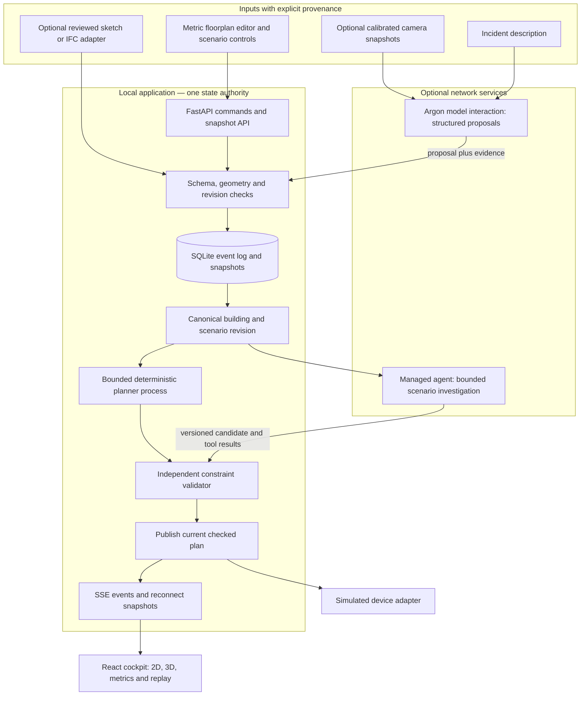

> Current implementation target: `charliegillet/SpatialTwin`, project root `/Users/nihalnihalani/Desktop/Github/SpatialTwin`. Read root `BUILD_PLAN.md` first. References to `winners/spatialtwin_argon_winner` below describe the historical source review, not a directory to clone or build. Prices, capabilities and source checks retain their original recorded dates.

# SpatialTwin — architecture and implementation plan

## Primary goal

Let a person change a building scenario in front of an audience and immediately see how a hazard, blocked door, or crowd distribution changes the evacuation plan, its bottlenecks, and the number of occupants that can reach an exit within a stated simulation horizon. Demonstrate this with an editable floorplan and a generated 3D view; a detailed physical model is optional.

Prepared 23 October 2026. Repository reviewed at commit `9fd96f7bfa93d82ce9fa6eac84cffc1e62829745`, folder `spatialtwin_argon_winner`. This is a researched implementation proposal, not a claim that the product has been built or validated for emergency use. Performance numbers below are targets unless explicitly described as observations.

Companion documents: [tool choices and source register](TOOL_SELECTION_AND_SOURCES.md) · [independent architecture challenge](ARCHITECTURE_REVIEW.md).

The [demo UI/UX and current Argon review](DEMO_UI_UX_AND_ARGON.md) specifies judge handoff, 3D/plan modes, proposal confirmation, synchronized comparison, failure states and the verified model-versus-agent capability split. Use captured stills for the core visual interaction; Argon does not support Live API.

**Build team:** Nihal, Charlie, Codex and Claude. The scope and schedule below assume these four contributors: two humans and two AI coding collaborators.

**Physical-demo extension:** use the [detailed physical build plan](PHYSICAL_DEMO_BUILD_PLAN.md) for the newly selected tabletop direction: a printed original plan, 24 RGB LEDs, one sensor-confirmed motorized connector, priced parts, exact wiring, AI/control contracts and four-contributor assignments. It supersedes earlier rough tabletop costs; the local numerical core and manual fallback remain prerequisites.

**Confirmed demo venue: SHACK15.** Use the [SHACK15 demo playbook](SHACK15_DEMO_PLAYBOOK.md) for the current flagship experience: a reviewed model of the actual event area, a fresh photo/annotated-plan challenge, and a checked intervention comparison. SHACK15's [official description](https://www.shack15.com/about) places it on the Ferry Building's top floor. Its one-floor model ends at explicitly scoped, finite-rate transfer boundaries; reaching those boundaries is not full-building evacuation. The lower marketplace map is contextual reference, not the SHACK15 room plan.

## 1. The architectural decision

Build a **local-first, single-floor, 2.5D scenario workbench**: an authoritative, measured 2D building graph with a 3D visualization generated from the same data. Use deterministic geometry and optimization for routing. Use Gemini 4 Argon to interpret images and incident descriptions, propose changes, investigate alternatives, and explain measured results.

The important demonstration is an audience member changing the problem and seeing a reproducible, auditable answer. Rich geometry, camera reconstruction, physical actuators, and autonomous code generation are separate extensions. They must not determine whether the core demo works.

Use a modular monolith: React/TypeScript in the browser and one FastAPI/Python backend. SQLite stores events, snapshots, plans, and run records. Run the solver in a bounded worker process. A Gemini adapter connects to model interactions; an optional managed-agent adapter runs a scenario investigation. Keep state ownership and publication in the backend.

### What should ship first

1. A self-authored four-room facility, two exits, door widths, room occupancy, and a visible scale.
2. Editable hazard and blockage controls that update both the 2D and 3D views.
3. A time-aware, capacity-constrained planner with an independent validator.
4. Baseline-versus-revised comparison with explicit assumptions and unassigned occupants.
5. A real Argon interaction that turns a novel description or annotated image into a proposed incident change.
6. A managed-agent investigation that uses the fixed solver and produces a checked comparison artifact as the flagship network workflow; disclose access/failure states and retain local fallback.
7. Event replay, visible source/freshness labels, and an offline mode that continues local computation.

### What changes from the repository

The folder contains six conceptual Markdown documents and two demo images; it does not contain an application, firmware, tests, or a working simulation package. Its core product idea is promising, but several claims cannot be inherited as engineering facts:

| Repository premise | Finding | Planning consequence |
|---|---|---|
| Supplied Python is a working evacuation simulator | The extracted code fails Python parsing with `unexpected indent`; its algorithm is static midpoint-radius filtering followed by independent shortest paths | Implement a new tested planner from documented graph APIs |
| `capacity=50` enforces crowd capacity | `shortest_path` ignores that attribute; the code only checks summed route counts afterward | Define throughput and occupancy separately, with time units |
| The code predicts 180 seconds of smoke diffusion | It uses a fixed radius with no temporal or fluid model | Call the MVP hazard layer a scenario envelope, not smoke physics |
| The agent must rerun until it returns `VERIFIED_SAFE` | Some scenarios have no feasible evacuation | Support zero flow, partial evacuation, timeouts, and invalid inputs |
| Any sketch becomes exact 3D geometry in three seconds | No reconstruction implementation or benchmark is supplied | Start with templates; image extraction creates a reviewable draft |
| 99.4% survival, four-second total latency, 92% win probability | No calibration, benchmark, or defensible probability model is supplied | Replace with measured latency, clearance curves, and constraint results |
| May-2026 agent ID and nested environment reuse are drop-in code | Current official examples use a newer agent and a different reuse pattern | Run the Phase 0 compatibility spike before integration |

The event itself is verifiable: the [organizer page](https://cerebralvalley.ai/e/gemini-4-argon-sf) lists 25 October 2026, 09:00–22:00 PDT, a maximum team size of four, and a Managed Agents prize. It does not establish that prizes can be combined, authorize advance implementation, or supply a guaranteed judging formula. Confirm build-period and submission rules before deciding what preparation is allowed.

## 2. Demonstrating the product without a detailed physical model

### A. Browser scenario workbench — recommended core

Left: a measured SVG floorplan. Center: a generated 3D cutaway. Right: incident evidence, constraints, solver events, and the plan comparison. Bottom: a simulation time slider and a visible status bar.

The audience can place a hazard, close a corridor, change an exit width, move an occupancy group, or select an unfamiliar template. These are real edits to a versioned scenario, not scene-specific animation triggers. A floorplan edit rebuilds both the routing graph and geometry. Start with rectangles and explicit door portals; avoid a general CAD editor.

Use Three.js `Shape`/`ExtrudeGeometry` or simple wall boxes for walls, and React Three Fiber for interaction and rendering. Extrusion takes existing shape data; it does not infer building topology from an image. Keep a 2D mode available on machines with weak graphics. See [Three.js extrusion](https://threejs.org/docs/pages/ExtrudeGeometry.html) and [R3F introduction](https://r3f.docs.pmnd.rs/getting-started/introduction).

**Why this proves the product:** the audience chooses a change the presenter did not preselect; the event log, new input hash, route allocation, and bottleneck metrics change together. A fixed initial map is acceptable if disclosed. Prove generality with a second template and a real topology edit.

### B. Printed plan + phone or webcam — best optional physical input

Print the exact demo floorplan with four known corner markers. Put a red card in a room and a black card over a marked door. An overhead camera estimates the cards' planar positions; a homography maps pixels to metric floor coordinates. A marker represents a simulated incident or blockage, not a detected real fire.

Use OpenCV ArUco detection, `findHomography`, and point transformation. Measure the page dimensions and explicitly map physical page coordinates to represented building meters. Use flat tokens or a ground contact point; the top of a tall block introduces parallax. Record reprojection error, test held-out positions, and reject frames with missing anchors or excessive error. ArUco is cooperative tracking; describe it honestly. It supplies planar position, not height or hidden structure. Use one stable camera before attempting two-camera fusion. See [OpenCV ArUco](https://docs.opencv.org/4.x/d5/dae/tutorial_aruco_detection.html) and [homography](https://docs.opencv.org/4.x/d9/dab/tutorial_homography.html).

Fast path: a local USB webcam. Stretch: a phone web page that sends compressed snapshots. Phone camera access requires a secure context; a remote phone opening a laptop's plain HTTP LAN address is not equivalent to localhost. Resolve HTTPS and local pairing before promising this mode. No cloud tunnel is necessary for the core demo.

### C. Sketch or photo import — Argon's onboarding contribution

Upload a sketch or screenshot. Ask Argon for room labels, wall segments, door candidates, exit candidates, and unresolved ambiguities in a schema. Overlay the proposal on the image. The operator supplies scale and confirms doors and exits. Only then compile the plan.

Limit the first supported input class to clean single-floor diagrams with visible doors. Target a few curated and held-out examples. A door missed by the model is an explicit uncertainty, never an invisible connection invented by the planner. Model confidence is not a calibrated geometric accuracy score.

**Cut line:** if editable image extraction is not reliable by integration freeze, keep image interpretation for incident cards and use the editor for geometry. That still demonstrates a meaningful multimodal model contribution.

### D. Sample building model import — credible extension

Use one appropriately licensed IFC sample, convert it offline with IfcOpenShell, or load it with a compatible web-ifc/That Open stack. Preserve element IDs, length units, storey transforms, and provenance. Manually validate the walkable topology and exits. Render the result as IFC-derived geometry or a GLB.

A mesh is not an evacuation graph. IFC geometry may omit reliable room connectivity, door state, or operating assumptions. The import adapter must produce the same canonical building schema as the editor. Keep IFC outside the MVP's dependency chain. See [IfcOpenShell geometry processing](https://docs.ifcopenshell.org/ifcopenshell-python/geometry_processing.html).

### E. Synthetic camera feed — optional test instrument

Blender can render a known facility, cards, occlusions, and camera angles; these frames provide controlled perception tests with ground truth. Label the feed synthetic. Feeding the workbench's own perfect coordinates back through a rendered image demonstrates integration but does not validate real camera perception. Use it for regression and outage rehearsal, not as undisclosed live footage.

**Order of investment:** canonical scenario and browser workbench → reliable planner/validator → real model interpretation → managed-agent investigation → printed-plan camera → IFC or synthetic footage. Run small API compatibility probes in parallel from the start. Pick only one optional input during the hackathon.

## 3. System architecture



### State ownership and consistency

The backend owns accepted state. The browser owns editor previews and camera position. A model response is an observation or proposal; it is not automatically the new building. An optimizer result is a candidate until validated. A device animation is a simulated output, not an acknowledgment from hardware.

On every accepted change:

1. Validate the command, `expected_revision`, dimensions, IDs, and source metadata.
2. Append the event and update the snapshot in one SQLite transaction.
3. Increment the revision and compute the canonical input hash.
4. Mark the prior plan stale immediately. Coalesce rapid input; keep the newest scenario queued.
5. Run the solver on an immutable snapshot in a process with a deadline.
6. Validate the returned plan against that same snapshot.
7. Publish only if its revision and hash still match current state.
8. Stream the result. The frontend rejects older revisions even if messages arrive late.

A single process serializes writes for the demo. CPU work does not block the async API loop. Cancel obsolete runs when possible; discard their results regardless of whether cancellation succeeds. Do not allow an unbounded backlog of camera frames or AI requests.

### Application interfaces — proposed, not vendor APIs

| Endpoint | Purpose |
|---|---|
| `GET /api/scenarios/{id}` | Current snapshot, revision, plan freshness and assumptions |
| `POST /api/scenarios/{id}/commands` | Typed command with expected revision and idempotency key |
| `POST /api/scenarios/{id}/observations` | Bounded image/marker observation with timestamp and calibration ID |
| `POST /api/scenarios/{id}/interpret` | Model-generated proposed command; never silently authoritative |
| `POST /api/scenarios/{id}/runs` | Start local solve or bounded agent investigation |
| `GET /api/scenarios/{id}/events` | SSE with event IDs, resume position, and heartbeat |
| `GET /api/runs/{id}` | Inputs hash, plan, validator report, timings and errors |
| `POST /api/scenarios/{id}/replay` | Create a separate replay session from saved events |
| `GET /health` | Local dependencies and network-adapter state without exposing secrets |

Use standard POST requests for commands and SSE for updates; bidirectional WebSockets are unnecessary for the initial workflow. Current FastAPI provides `fastapi.sse.EventSourceResponse`; its official guide identifies support starting at 0.135.0. Pin a tested compatible release rather than relying on an old environment. See [FastAPI SSE](https://fastapi.tiangolo.com/tutorial/server-sent-events/).

SSE event IDs must support reconnect. If an event is no longer retained, send a fresh snapshot and resume from that revision. Disable buffering in any reverse proxy. Serve the built frontend and API from one local origin during the demo.

### Persistence

Keep `scenario`, `event`, `snapshot`, `run`, `plan`, `observation_metadata`, and `agent_trace` tables. Store images separately with local paths and hashes; retain only what is needed for the demo. A run records `scenario_revision`, `input_hash`, `solver_version`, `assumptions_version`, random seed if used, start/end timestamps, and validator outcome.

SQLite WAL is suitable for a local application with serialized writes and concurrent reads; it still has a single writer. Do not place the live database on a network filesystem. Export a consistent backup using the database backup mechanism. See [SQLite WAL](https://www.sqlite.org/wal.html).

### Proposed implementation layout

The following files are to be created during implementation; they do not exist in the source playbook:

```text
spatialtwin/
  apps/web/src/
    editor/                 # SVG plan and constrained edits
    scene/                  # generated 3D view; one coordinate adapter
    evidence/               # metrics, sources, uncertainty and tool events
    api/                    # generated types and SSE client
  services/api/spatialtwin/
    domain/                 # Pydantic contracts and semantic validation
    state/                  # event reducer, revisions, SQLite transactions
    planning/compiler.py    # metric topology -> time-expanded network
    planning/optimizer.py   # all-population two-pass flow
    planning/decompose.py   # source-tagged physical schedules
    validation/             # independent schedule/resource checker
    adapters/gemini.py      # typed model proposals
    adapters/managed.py     # agent jobs and artifact retrieval
    adapters/camera.py      # optional calibration and observations
    routes/                 # commands, snapshots, runs and SSE
  fixtures/                 # hand-computable graphs and owned layouts
  tests/                    # numerical, state-race and browser tests
  agent_bundle/             # pinned tool package, skill and manifest
  docs/                     # assumptions, benchmarks, setup and demo
```

Define one schema owner: Pydantic contracts export the JSON/OpenAPI schema and TypeScript types. Avoid hand-maintaining two drifting versions. A developer launcher starts the frontend/API; a presentation launcher serves the built frontend from the backend, uses bundled assets and loads a clean scenario. Exact launcher commands belong in the eventual tested README, rather than being presented here as already-working commands.

## 4. Canonical world model and contracts

Use meters and seconds internally. Define world axes once: `(x, y)` on the floor and `z` upward. Convert explicitly into the renderer's axes. A camera transform includes pixel dimensions and a calibration revision. Never mix normalized coordinates, pixels, millimeters, and meters implicitly.

| Record | Required fields and meaning |
|---|---|
| `Building` | ID, schema version, floor ID, metric bounds, rooms, walls, portals, walkable cells, graph compilation version |
| `Room` | Polygon, label, occupancy assumption, maximum modeled occupancy, floor elevation |
| `Portal` | Stable ID, endpoints/rooms, position, width in meters, state, allowed direction, accessibility attributes, declared throughput |
| `OccupantGroup` | Source room/cell, integer count, scenario provenance, common modeled mobility profile |
| `Observation` | Source type, capture/receive times, image hash, proposed entities, confidence/quality, calibration ID, accepted/rejected status |
| `HazardScenario` | Affected rooms/cells/edges, unavailable-at times, uncertainty margin, rule version, source and whether synthetic |
| `Plan` | Revision/hash, horizon, allocated schedules, unassigned count, per-cell occupancy, per-portal throughput, assumptions and validator report |
| `DeviceCommand` | Plan hash, revision, target, desired demo state, TTL, idempotency key, simulated/physical flag and acknowledgment |

Example accepted command:

```json
{
  "type": "set_portal_state",
  "scenario_id": "facility-demo",
  "expected_revision": 17,
  "idempotency_key": "judge-edit-004",
  "source": {"kind": "manual", "label": "Audience input"},
  "payload": {"portal_id": "exit_b", "state": "blocked"}
}
```

Example plan summary:

```json
{
  "scenario_revision": 18,
  "input_hash": "sha256:...",
  "status": "PARTIAL_WITHIN_HORIZON",
  "horizon_seconds": 120,
  "occupants_total": 65,
  "assigned_to_exit_by_horizon": 48,
  "unassigned_by_horizon": 17,
  "constraint_violations": [],
  "model_scope": "single_floor_common_mobility_synthetic_hazard"
}
```

The numbers in this example illustrate the schema; they are not an observed result. Use statuses such as `COMPLETE_WITHIN_MODEL`, `PARTIAL_WITHIN_HORIZON`, `NO_FEASIBLE_EXIT_WITHIN_HORIZON`, `INVALID_INPUT`, `SOLVER_TIMEOUT`, and `STALE`. A constraint-valid plan can still leave people unassigned. Report validity and completeness separately.

For the MVP, replanning occurs in a paused what-if scenario and restarts the illustrative evacuation from its declared initial occupancy. Do not animate partly evacuated people teleporting back to their original rooms. A later live drill mode must replan from current cell occupancy, in-transit commitments, and an immutable simulation clock.

## 5. Deterministic planner and hazard model

### MVP scope

One floor, one common mobility/speed class, explicit walkable topology, fixed corridor directions per scenario, modest graph size, synthetic incident assumptions, and a finite horizon. Initial templates use simple source/staging rooms. The same accessibility filter applies to everyone in a run. Mixed walking speeds, opposing flows, stair congestion and multi-floor routing are explicit upgrades.

Do not run independent planners for different groups while letting each consume the entire shared capacity. Single-commodity flow is appropriate only while occupants share the same modeled movement rules. Preserve source-group allocation by decomposing the computed flow, not by inventing individual trajectories in the renderer.

### Step 1 — compile validated walkable topology

Templates contain room polygons, walls and explicit door portals. The compiler creates room/portal connections and corridor microcells. Check polygon validity, positive dimensions, exits on a valid boundary, door adjacency and path segments crossing walls only at an allowed portal. Reject malformed or ambiguous geometry explicitly. Accept valid disconnected topology and report which occupant sources cannot reach an exit.

For a first demo, compile a few designed templates rather than arbitrary freehand geometry. Topology edits are constrained operations such as adding an exit portal or blocking a named corridor. Reject a dragging operation that would make the map invalid.

### Step 2 — give every capacity a unit

- `q_e`: declared portal throughput in persons/second; use slot quota `B(t+Δt)−B(t)`, with `B(t)=floor(q_e*t)`. This equals constant `floor(q_e*Δt)` only when the per-slot rate is integral.
- `k_c`: modeled occupancy limit in persons in a room or corridor microcell at a time.
- `τ_e`: travel duration in seconds; round travel time upward to a whole number of slots.
- `Δt`: simulation discretization, initially 1–5 seconds according to graph size and fixture needs.
- `H`: finite planning horizon, initially 120 seconds for the presentation.

These are configurable simulation assumptions. They are not certified limits inferred from door width by a language model. Very low rates can round to zero. Use a cumulative integer token schedule, `B(t)=floor(q_e*t)` and slot quota `B(t+Δt)-B(t)`, or a coarser time step when appropriate. Smaller time steps make the naive rounding problem worse. Document token batching and test total service over the horizon; do not silently inflate capacity.

Model time is distinct from wall-clock solve time. A 120-second horizon does not mean waiting 120 real seconds for the result.

### Step 3 — represent time and occupancy

Expand each walkable cell across the time slots. Split each cell/time node into `in` and `out` with capacity `k_c`. Add valid wait arcs and movement arcs to the next time layer. Route injection, waiting and movement through the same occupancy constraint. Split longer corridors into explicit microcells so occupants consume occupancy while in transit.

A movement cannot skip intermediate occupied or hazardous intervals. An assigned exit route must remain admissible for its full traversal, including waiting, not merely at departure. Compute travel slots from `ceil(length_m / (speed_m_per_s * Δt))`; split the route into a chain with the corresponding duration. Include declared source-to-portal travel distance, or label its omission explicitly in a mathematical unit fixture. Count occupancy and door crossings consistently at slot boundaries and document the convention.

Keep physical waiting occupancy for trapped occupants even when the synthetic hazard reaches them: a hazard does not make people disappear. In the MVP, hazard closures are permanent for the rest of the horizon. Remove all movement into/out of an unavailable cell and disable its successful-exit connection, while retaining physical hold arcs. Such a path can end only as unresolved/unassigned, never as a successful exit route. This supports complete population accounting without calling hazardous waiting safe. Reopening hazard cells or tracking temporary exposure would require explicit additional state and validation.

For the MVP, set a fixed allowed direction for each corridor per planning run. Do not independently give both directions the full corridor capacity. Do not use a shared bottleneck gadget that accidentally allows paths to turn around or teleport between endpoints. If the real problem requires flexible opposing traffic, use a different optimization model before expanding the product claim.

### Step 4 — account for everyone, then optimize two objectives

A maximum-flow-only graph can omit people who do not get exit routes, understating occupancy. Use **all-population flow** instead: inject all `N` people at time zero. Their paths consume occupancy until a successful exit or the horizon. Actual exits connect to an `EXIT` collector; remaining physical states at the horizon connect to an `UNASSIGNED` collector. Everyone reaches exactly one collector, and unassigned people remain visible in the physical schedule.

1. **Maximize successful exits:** solve minimum-cost flow with source demand `−N`, final sink demand `+N`, and collector connections to that sink. All costs are zero except `EXIT → sink`, with cost `−1` per person. The optimal cost is `−F`, where `F` is the maximum number assigned to an exit. The forward-time graph has no negative cycles. This is a direct objective, not an arbitrary penalty constant.
2. **Optimize the schedule at that exact exit count:** remove the common final sink; set source demand `−N`, `EXIT` demand `+F`, and `UNASSIGNED` demand `+(N−F)`. Minimize nonnegative integer travel/arrival/queueing costs, with the weighting and tie-break policy documented.
3. Report `N−F` and its locations as unassigned by the horizon. Distinguish static disconnection from horizon, throughput, and hazard restrictions; causes can overlap. Flag unresolved hazard exposure among those remaining.

In both passes, use NetworkX `min_cost_flow(G, demand="demand", capacity="capacity", weight="weight")`. The total source-injection arc capacities equal `N`; supplying all `N` forces every origin count into the schedule. Set finite integer capacities on every arc. Initial occupancy must be valid. A physical hold-at-origin fallback permits population accounting when exits are blocked, without implying those occupants are safe. See [NetworkX minimum-cost flow](https://networkx.org/documentation/stable/reference/algorithms/generated/networkx.algorithms.flow.min_cost_flow.html).

Decompose paths to both collectors, not just the successful ones. The validator counts waiting, transit and residual occupants throughout. Never treat flow into the `UNASSIGNED` collector as evacuation, and never interpret a finite-horizon optimum as a guarantee about a real building. A simpler maximum-flow → fixed-flow-cost spike was tested during research, then superseded by this formulation when the residual-occupancy gap was identified.

### Step 5 — independently validate the schedule

Check conservation of all `N` occupants and both collector totals; each leg departs no earlier than the preceding leg arrives; valid room-to-portal connectivity; portal throughput per slot; cell occupancy including every wait/transit/residual path; no blocked movement or unavailable waiting on a successful exit path; exit/horizon constraints; and exact snapshot provenance. Validate the decomposed paths as well as the aggregate flow. Physical holding in a hazardous cell is reported as unresolved exposure, separately from successful-path validity. UI animation follows this schedule.

The validator should consume the canonical map and the candidate schedule directly. It must not simply trust the solver's `verified=true` field or reuse every graph-compilation assumption unchecked. For a small fixture, enumerate schedules independently or compare against hand-calculated results.

### The hazard layer: explicit and honest

First implementation: a scenario author sets permanent room or corridor unavailable-at times. An optional graph-distance spread rule derives those times from a declared propagation speed and portals. This is an illustrative stress scenario, not a simulation of fire chemistry, visibility, toxic dose, or ventilation. The physical whereabouts of stranded people remain accounted for after a closure; their exposure is unresolved.

Show the assumed arrival envelope and its uncertainty separately from observed incident markers. Use a conservative uncertainty buffer and a sensitivity comparison. Never let a translucent smoke shader become the numerical hazard model.

Higher fidelity path: validate pedestrian motion with JuPedSim, then add a separately versioned CFAST zone-model or FDS simulation input for specific prebuilt scenarios. These engines need suitable geometry, material/source/boundary inputs and validation; installing one does not make live RGB footage a physical sensor. Do not put CFD in the live replanning loop. See [JuPedSim](https://www.jupedsim.org/), [NIST CFAST](https://pages.nist.gov/cfast/), and [NIST FDS/Smokeview](https://pages.nist.gov/fds-smv/).

### Required mathematical fixtures

| Fixture | Expected result |
|---|---|
| 12 occupants, two direct exits, each allowing 2 persons per 5-second slot, three slots, sufficient waiting space | 12 assigned by 15 seconds; 6 through each exit |
| Same fixture, one exit closed | 6 assigned; 6 unassigned by the horizon |
| Same fixture, both exits closed | 0 assigned; 12 unassigned; no fabricated route |
| Portal that becomes unavailable before a planned crossing | That crossing is absent from the validated schedule |
| Corridor travel spans several slots | Its intermediate cell occupancy is checked throughout |
| Only part of a group receives an exit route | Both successful and residual physical paths remain counted every slot, including shared cells |
| Residual occupants remain after their source becomes unavailable | Report unresolved exposure/stranding; do not claim whole-population hazard validity |
| Required exit path longer than the horizon | Unassigned by horizon, distinct from static disconnection |
| Add one person over a room's modeled initial occupancy limit | Reject invalid input or explicitly change the assumption; do not silently lose a person |
| Two input edits while an earlier solve is running | Earlier result cannot publish against the latest revision |

The direct-exit fixture is a unit-test network with exactly one-slot exit travel, not a claimed simulation of a real building.

## 6. Argon and managed agents: useful, bounded roles

### Model interactions

Argon has three valuable jobs: extract a structured incident proposal from an annotated image; turn natural language such as “the east exit is blocked and 20 people moved to Lab B” into typed edits; and explain a checked before/after result with its assumptions. It may propose geometry during onboarding, but a person confirms scale and topology.

The model does not decide whether a route satisfies numeric capacity, write arbitrary emergency control code, infer actual crowd counts from symbolic coins, or calculate survival rates. The main value is mapping messy human input into a reviewable scenario and investigating the consequences.

Official structured-output pattern, adapted to the application's schema:

```python
from google import genai

client = genai.Client()
interaction = client.interactions.create(
    model="gemini-4-argon",
    input=incident_input,  # typed text/image blocks from the documented image guide
    response_format={
        "type": "text",
        "mime_type": "application/json",
        "schema": IncidentProposal.model_json_schema(),
    },
)
proposal = IncidentProposal.model_validate_json(interaction.output_text)
```

`IncidentProposal` and `incident_input` are application-owned definitions to implement, not SDK classes. Parse and then check semantics: valid IDs, metric bounds, timestamps, source revision, integer counts, and ambiguous references. JSON schema conformance does not establish factual correctness. See [Gemini structured outputs](https://ai.google.dev/gemini-api/docs/structured-output).

Bound image size and request frequency; send a latest stable frame after a meaningful change, not every video frame. Keep one request in flight per camera source, debounce changes, time out cleanly, and visibly identify rejected or uncertain observations. A card obscuring a door does not prove the actual door is mechanically closed.

### Managed-agent investigation

Use the managed agent for one explicit question: “Compare the current evacuation with opening the alternate *simulated* exit; show the constraint and allocation differences.” It can inspect a snapshot, invoke approved tools or the pinned solver package in its sandbox, validate outputs, and produce a comparison artifact. This demonstrates real tool use and iteration on an audience-selected scenario.

Keep the local planner available while this job runs. Start the investigation early enough that network latency cannot stall the presentation. If a candidate fails validation, surface the actual error. The agent may correct a bounded input or propose a different allowed intervention; it cannot change capacity assumptions to force a successful label.

Current documented configuration:

```python
first = client.interactions.create(
    agent="antigravity-preview-09-2026",
    agent_config={"type": "antigravity", "model": "gemini-4-argon"},
    input="Inspect the supplied scenario and run the pinned comparison tool.",
    environment="remote",
)

followup = client.interactions.create(
    agent="antigravity-preview-09-2026",
    agent_config={"type": "antigravity", "model": "gemini-4-argon"},
    input="Explain the checked difference for the same input revision.",
    environment=first.environment_id,
    previous_interaction_id=first.id,
)
```

This is a documentation-based compatibility pattern, not a completed integration. Mount the pinned package, scenario and `.agents/skills/scenario-audit/SKILL.md` using documented environment sources. Re-specify per-interaction tools and instructions. Preserve the environment ID separately from the conversation ID. Use a fresh scenario snapshot and hash for every investigation. See [environment reuse](https://ai.google.dev/gemini-api/docs/agent-environment) and [custom agent skills](https://ai.google.dev/gemini-api/docs/custom-agents).

Important integration boundaries:

- Managed Antigravity agents currently do not support structured outputs. Retrieve a tool-produced JSON artifact or a function result and validate it; do not pass the model `response_format` into the managed-agent path.
- Poll or stream the documented events. `interaction.steps` and `output_text` exist in current examples, but their payloads are not a stable application event schema. Normalize them behind the adapter.
- The environment can stop after inactivity and resume from saved state. A reused ID is not a latency guarantee. Test a cold/resumed run.
- Handle `requires_action`, tool errors, `failed`, `cancelled`, `incomplete`, deadline expiry and unexpected statuses. Background execution needs stored interactions; do not combine it with `store=false`.
- Native code execution in an agent is not a reason to trust its code. Pin the solver version; accept artifacts only after local validation against the exact input hash.

See [Antigravity capabilities and limitations](https://ai.google.dev/gemini-api/docs/antigravity-agent), [managed-agent quickstart](https://ai.google.dev/gemini-api/docs/managed-agents-quickstart), and [Interactions state and storage](https://ai.google.dev/gemini-api/docs/interactions-overview).

### Tools available to the agent

These are proposed application tool contracts. Their implementation is shared by local function calling, sandbox CLI and optional MCP; they are not different solvers.

| Tool | Permitted effect |
|---|---|
| `get_scenario(revision)` | Read immutable snapshot and assumptions |
| `solve_scenario(snapshot_hash, intervention)` | Run pinned solver on an allowed simulated intervention |
| `validate_plan(snapshot_hash, plan_hash)` | Return independent constraint report |
| `compare_runs(baseline_id, candidate_id)` | Return metrics and assumption differences |
| `submit_candidate(run_id)` | Propose a checked result for publication; backend still enforces revision |

Bound investigations to a small number of tool rounds and one explicit retry policy. Enforce a deadline and a model token budget supported by the selected SDK. Do not expose real device-control tools. A self-correction sequence must arise from an actual tool or validation result; show a naïve baseline comparison as a baseline, not as a fabricated agent failure.

### MCP and hardware

MCP is an optional interoperability adapter, not the architectural center. For a cloud agent, a localhost MCP server is unreachable without additional networking. Prefer client-side function calls for the first version. If remote MCP is justified, use authenticated Streamable HTTP, an explicit allowed-tools list and a lowercase server name such as `facility`; test the exact SDK combination. The official page has inconsistent prose about name characters, so avoid relying on ambiguous names.

Simulate doors, LEDs and a fan state in the browser. Mark those outputs `SIMULATED`. A physical extension uses a local gateway, idempotent commands, TTL, operator approval and acknowledgment. Neither a language model nor a shader can verify real HVAC safety. The generic two-wire fan in the original shopping list should not be assumed reversible; check an actual part and driver before any hardware work.

## 7. Cockpit and demonstration

### The interface

- **Input panel:** manual/AI/camera source, thumbnail or marked floorplan, scale, capture time, calibration quality, accepted observation.
- **Twin panel:** 2D/3D toggle, hazards, blocked portals, route allocations, occupancy animation, labeled exits and assumptions.
- **Evidence panel:** current revision, solver status, validation checks, before/after chart, actual agent tool calls and outputs.
- **Control strip:** pause/reset, scenario time, change occupancy, move hazard, block exit, new scenario, offline toggle.

Use high contrast and legible labels, but avoid “all clear” or “survival” UI. Distinguish accepted input, model proposal, predicted scenario envelope and stale plan by more than color. Provide keyboard controls and a reduced-motion option. A timeline plays a recorded event session only when the UI says `REPLAY`.

Metrics worth showing: assigned/unassigned by horizon; exit throughput curve; largest modeled queue; clearance time when everyone is assigned; minimum assumed hazard margin; solver runtime; perception runtime; and latest observation age. Show `not available` for clearance time when the horizon does not clear everyone. Explain that animation particles may aggregate a group while the numeric schedule retains exact counts.

### Two-minute core demo

| Time | Action and visible proof |
|---|---|
| 0–15 s | State the scope: a scenario workbench with measured geometry, synthetic hazards and checked routing; show the initial map |
| 15–35 s | Audience selects an exit and introduces a novel blockage, via editor or a calibrated card |
| 35–55 s | Argon interprets a description/image into a visible proposal; accept it; show the changed revision and evidence |
| 55–80 s | Local planner produces a schedule; compare the original route allocation, bottleneck and unassigned count |
| 80–105 s | Show a managed-agent investigation started earlier, if completed; otherwise continue the local live comparison with its network state visible |
| 105–120 s | Block both exits and show the honest zero-flow result, then demonstrate that reset/replay reproduces the state |

Do not promise any cloud step will finish inside its presentation segment before it has been measured. For slower model access, perform the live semantic interpretation first, then let the audience change a manual control while the investigation proceeds.

### Outage ladder

1. **Normal:** live model interpretation + local solve + optional live agent investigation.
2. **AI network unavailable:** manual typed scenario controls + the same local solver; show `AI OFFLINE`.
3. **Camera unreliable:** editor input; show that camera calibration is unavailable.
4. **3D rendering problem:** 2D plan and metrics continue.
5. **Application problem:** clearly labeled saved replay or a backup video, never presented as live inference.

An outage mode should be a rehearsed button, not a last-minute code change. The offline path can have templated explanations; it must not pretend to have called Argon.

## 8. Implementation phases

### Phase 0 — Documentation discovery and compatibility spike

**How this serves the primary goal:** removes uncertainty about the APIs and validates the smallest useful technical path before the team invests in the presentation.

**Implement/produce:** a capability matrix; tested dependency lockfiles; one model structured-output call; one managed-agent call with a mounted tiny script; one environment reuse call; one SSE event; and the hand-computable solver fixtures. Use synthetic data. Confirm event build rules, access, model IDs and team constraints. Record unsupported combinations rather than guessing parameters.

**Documentation to copy:** the official [structured-output recipe example](https://ai.google.dev/gemini-api/docs/structured-output#structured-output-examples), [agent quickstart](https://ai.google.dev/gemini-api/docs/managed-agents-quickstart), [environment reuse example](https://ai.google.dev/gemini-api/docs/agent-environment#configure-an-environment), [NetworkX flow signatures](https://networkx.org/documentation/stable/reference/algorithms/generated/networkx.algorithms.flow.min_cost_flow.html), and [FastAPI SSE guide](https://fastapi.tiangolo.com/tutorial/server-sent-events/).

**Verification:** compile/type-check against pinned SDKs; store sanitized request/response fixtures; verify a reused environment reads its own file; inspect a failed/no-route case; distinguish documented support from account-level live access.

**Guards/cut line:** no inherited May agent ID, invented sandbox fields, managed-agent JSON-schema mode or streaming event names. If managed access is unavailable after a bounded setup attempt, keep the adapter interface and ship model interactions; disclose the limitation and do not claim the managed-agent track integration.

### Phase 1 — Canonical scenario and editable floorplan

**How this serves the primary goal:** gives the audience a real problem they can change and makes every display and computation refer to the same geometry.

**Implement:** Pydantic schemas, immutable revisions, event reducer, SQLite transaction, constrained SVG editor, two self-authored templates, and a room/portal graph compiler. Provide local import/export of the canonical JSON. Export the API schema for TypeScript types.

**Documentation references:** [SQLite WAL](https://www.sqlite.org/wal.html); application contracts in sections 3–4; Three.js shape data in section 2. Read schema/library examples for the exact pinned release before writing the compiler.

**Verification:** edit a door and confirm graph and view update together; reject malformed polygons, unknown portal IDs and inconsistent units; restore a snapshot and reproduce its hash; reject stale expected revisions and duplicate mutations.

**Guards:** no second independent hardcoded map in the renderer, no implicit unit conversions, no unvalidated AI geometry entering accepted state.

### Phase 2 — Time-aware planner and independent verifier

**How this serves the primary goal:** makes route changes and bottleneck numbers defensible under explicit simulation assumptions.

**Implement:** time-expanded graph with cell occupancy and portal throughput; two-pass all-population minimum-cost flow; successful and residual schedule decomposition; independent validator; structured errors; bounded worker process; permanent scenario unavailable-at schedules and unresolved-exposure labels. Persist solver and assumption versions.

**Documentation references:** [min_cost_flow](https://networkx.org/documentation/stable/reference/algorithms/generated/networkx.algorithms.flow.min_cost_flow.html), section 5 and the companion tool report's executed all-population formulation findings.

**Verification:** all mathematical fixtures; arrival-time/hazard boundary tests; shared-capacity and occupancy tests; intentional invalid candidate rejected independently; fixed-input determinism; graph-size deadline and memory guard.

**Guards:** no per-group shortest paths passed off as capacity optimization, arbitrary `capacity=50`, successful exit paths waiting in unavailable cells, disappearance of trapped occupants' physical holding, opposite-direction double counting, or successful label on an incomplete plan.

### Phase 3 — 3D cockpit, evidence and replay

**How this serves the primary goal:** makes the consequences of a change immediately understandable and lets an audience inspect and reproduce the result.

**Implement:** R3F scene generated from canonical geometry; route and hazard overlays; allocation/queue charts; actual event stream; source, uncertainty, revision and stale labels; replay session; simulated device states; 2D fallback. Keep visualization independent from numerical computation.

**Documentation references:** [R3F Canvas](https://r3f.docs.pmnd.rs/api/canvas), [R3F hooks](https://r3f.docs.pmnd.rs/api/hooks), [Three.js ExtrudeGeometry](https://threejs.org/docs/pages/ExtrudeGeometry.html), [FastAPI SSE](https://fastapi.tiangolo.com/tutorial/server-sent-events/).

**Verification:** overlays line up with canonical coordinates; route animation matches schedule; stale events never replace current state; replay reconstructs the same input hash and metrics; keyboard/2D modes work.

**Guards:** no fake live terminal, animated “smoke physics,” invented percentages, or React state changes for every particle on every frame. Pool/instance repeated geometry and separate camera state from scenario state.

### Phase 4 — Argon semantic and visual interpretation

**How this serves the primary goal:** lets someone express an incident in ordinary language or an image and see the proposed interpretation grounded in the map.

**Implement:** direct model interaction adapter; `IncidentProposal` schema; image metadata; semantic validator; review overlay; bounded request queue; retries/backoff and timeout; metrics and sanitized traces. Start with text edits and annotated-image interpretation, then add sketch onboarding only if reliable.

**Documentation references:** [structured outputs](https://ai.google.dev/gemini-api/docs/structured-output), [Interactions overview](https://ai.google.dev/gemini-api/docs/interactions-overview), current model/image guide linked from the official docs index.

**Verification:** novel text/input not copied from the prompt examples; ambiguous room name yields a proposal needing correction; unknown IDs and out-of-bounds positions are rejected; a late response for an old revision cannot mutate state; network failure leaves manual editing available.

**Guards:** no interpreting JSON shape as truth, treating model confidence as calibrated probability, or chaining every camera frame as the building's database.

### Phase 5 — Managed-agent investigation and checked comparison

**How this serves the primary goal:** demonstrates a useful agent that inspects alternatives and verifies its work on the audience's scenario.

**Implement:** mount pinned solver/validator package and skill; start one bounded investigation; normalize genuine tool events; retrieve a comparison artifact; locally validate it; show model and environment provenance. Use function calls before adding remote MCP.

**Documentation references:** [custom agent file/skill sources](https://ai.google.dev/gemini-api/docs/custom-agents), [agent model selection and limitations](https://ai.google.dev/gemini-api/docs/antigravity-agent), [environment lifecycle](https://ai.google.dev/gemini-api/docs/agent-environment), [quickstart streaming](https://ai.google.dev/gemini-api/docs/managed-agents-quickstart#stream-response).

**Verification:** same scenario revision locally and remotely; package hash agrees; actual tool failure is visible; malformed artifact rejected; timeout/incomplete status shown; resumed environment tested; no real actuation permissions exist.

**Guards:** no unsupported structured output on managed agents, remote sandbox as the only planner, package installation on every incident, code rewriting in the active planner, or forced self-correction theater.

### Phase 6 — SHACK15 grounding and one optional input

**How this serves the primary goal:** connects a reviewed model of the actual judging area to fresh visual evidence without requiring a detailed physical model.

**Implement:** prepare the reviewed SHACK15 room fixture during Phases 1–3, then use this phase to validate fresh room-photo/annotated-plan grounding against canonical IDs. Add source/floor/boundary metadata and finite transfer receiving rates from the [venue playbook](SHACK15_DEMO_PLAYBOOK.md). A photographed judge-annotated original plan is the first backup. Add ArUco automatic token positioning only if it already works; IFC and room scanning stay stretch options outside the flagship dependency chain.

**Documentation references:** [OpenCV ArUco](https://docs.opencv.org/4.x/d5/dae/tutorial_aruco_detection.html), [homography](https://docs.opencv.org/4.x/d9/dab/tutorial_homography.html), [IfcOpenShell](https://docs.ifcopenshell.org/ifcopenshell-python/geometry_processing.html), companion tool matrix.

**Verification:** held-out room/plan annotations identify reviewed canonical portals or return `needs_confirmation`; wrong-floor/stale proposals are rejected; destination counts use the correct floor-boundary label and finite receiving assumptions. If token tracking is included, test held-out positions and lost calibration. Every adapter produces the same canonical event types as the editor.

**Guards:** no substituting the marketplace map for SHACK15, claiming a visitor graphic is an as-built blueprint, or treating a floor-transfer count as building evacuation. No claiming planar homography measures height, IFC meshes imply exits, or synthetic frames prove live-camera accuracy. Drop optional scanning/tracking/import work if it threatens rehearsal time; retain the reviewed venue schematic and annotated-plan input.

### Phase 7 — Verification, packaging and rehearsal

**How this serves the primary goal:** makes the live product dependable, honest and understandable when networking, cameras or inputs misbehave.

**Implement:** a local launcher, offline assets, health check, dependency locks, fixture bundle, consistent backup/export, replay and short backup video; license/source manifest; demo script; failure-mode buttons. Produce a technical README with exact setup, model access, assumptions and known limits.

**Documentation references:** [Playwright test setup](https://playwright.dev/docs/intro), official guides referenced by each adapter, and all acceptance criteria in section 10.

**Verification:** meaningful unit/property tests for solver and schema boundaries; Playwright flows for edits/reconnect/fallback; both exits blocked; stale model and solver race; offline restart; five consecutive full rehearsals with no manual data repair. Check that implementation matches the pinned vendor examples, and search for inherited model IDs, hardcoded success labels and unsupported configuration.

**Guards:** no last-minute optional engines, live dependency downloads, key exposure in frontend bundles, noisy alarms/smoke effects, or claims beyond the measured build.

## 9. Staffing, schedule and cut lines

The build team is **Nihal, Charlie, Codex and Claude**. Keep the full four-contributor scope. The provisional target is a 10–12-hour elapsed build window, including human review, AI handoffs and integration. Confirm API access in Phase 0. The event listing's opening hours are not a confirmed coding/submission schedule; use time relative to the permitted build start.

| Contributor | Primary ownership | Deliverable and handoff |
|---|---|---|
| **Nihal — product and integration lead** | Scenario requirements, owned layouts, runtime/access setup, integration decisions, optional camera setup, demo and acceptance | Supplies the acceptance scenarios, coordinates merges, runs the real environment and signs off the end-to-end demonstration |
| **Charlie — interface and spatial experience** | Floorplan editor, 2D/3D views, route/occupancy visualization, evidence panels, replay controls and optional camera UX | Owns `apps/web`; consumes the published schema and fixtures; proves audience changes are visible and understandable |
| **Codex — numerical and application core** | Canonical schemas, graph compiler, all-population planner, independent schedule validator, state/revisions, API, persistence and local packaging | Owns backend core and generated contract types; delivers a checked run API with reproducible numerical fixtures |
| **Claude — Gemini integration and adversarial verification** | Model proposals, managed-agent/tool adapters, agent bundle, AI failure handling and independently derived adversarial fixtures | Owns Gemini/managed adapter files and agent bundle; challenges Codex's results against the written specification and checks invalid AI outputs |

**Shared-file rule:** Codex owns contract/schema changes; Charlie and Claude consume generated types and versioned fixtures. Agree on payloads, statuses and two example scenarios in the first hour. A contract change after that needs a coordinated update across consumers. Use separate branches/worktrees and explicit file ownership during implementation; Nihal coordinates integration and acceptance. This plan does not create branches or message the other contributors.

**Independent review:** Claude derives expected counts and adversarial cases from the specification rather than copying solver outputs. Codex checks AI proposals, artifact validation and stale-result handling against the same contracts. Each contributor fixes defects in their owned lane. Nihal and Charlie exercise the integrated product with fresh inputs.

| Relative time | Nihal: product/integration | Charlie: interface/spatial UX | Codex: backend/planning | Claude: AI/adversarial checks |
|---|---|---|---|---|
| T+0–1 h | Define demo/acceptance scenarios; verify access and local runtime | Editor/scene skeleton using the agreed fixture | Publish schema, API examples and tiny all-population fixture | Probe live model/agent APIs; independently derive adversarial expectations |
| T+1–3 h | Integrate the first thin end-to-end slice | Editable template and matching 2D/3D | Template → graph → checked fixture-run API; revision guard | Typed interpretation adapter; invalid-proposal and numerical fixture checks |
| T+3–5 h | Exercise fresh scenarios and resolve integration issues | Metrics, schedule animation and proposal review UI | Full schedule decomposition, occupancy validation, SSE and persistence | Bounded requests, real tool events and managed investigation |
| T+5–7 h | End-to-end acceptance and demo script | Replay, freshness labels and comparison | Deadline/graph limits, reconnect and local packaging | Artifact checks, stale-response attacks and API outage behavior |
| T+7–8 h | Freeze scope; optional camera setup only if core is green | Stabilize cockpit; optional camera UX | Fix core defects and validate all numerical fixtures | Stabilize the working AI path and finish adversarial checks |
| T+8–10 h | Lead full rehearsals, offline startup and backup recording | Polish legibility and fix demonstrated UX defects | Fix numerical/runtime failures found in rehearsal | Verify failure labels and genuine agent evidence during rehearsal |
| T+10–12 h | Submission and integration buffer | Buffer | Buffer | Buffer |

**Critical dependency:** agreed schema → graph compiler → solver/validator → publication → visualization. UI and AI can work in parallel using synthetic fixtures, but fixtures must carry a visible development label and be removed from live mode.

**Integration gates:** by T+1 h, the four lanes share contracts and fixtures; by T+3 h, a browser edit reaches a real checked fixture-run API; by T+5 h, the main scenario completes the local planning/visualization loop; by T+7 h, the core is rehearsable and only demonstrated integrations remain. These are coordination targets, not guarantees. Codex's backend/planner lane is the critical bottleneck: prioritize the first working vertical slice, then complete persistence and packaging without relaxing population accounting or validation.

**Mandatory freeze:** after T+7 h, remove rather than debug optional integrations that threaten the core. Never remove no-route handling, validation, source labels or offline manual controls to save time.

## 10. Acceptance criteria and measurement

### Functional and numerical gates

| Area | Pass condition |
|---|---|
| State | Accepted edits replay to identical canonical input hashes; stale/duplicate commands have defined behavior |
| Geometry | 2D, 3D and graph derive from one metric schema; wall/portal consistency checks pass |
| Planning | Conservation, slot throughput, wait/transit occupancy and hazard interval checks pass independently |
| Infeasibility | Partial and zero-flow fixtures return correct counts and reasons without fabricated routes |
| Provenance | Every displayed plan names revision, assumptions and source freshness |
| AI | At least one unfamiliar audience-style input produces a valid reviewable proposal; invalid/uncertain inputs fail visibly |
| Managed agent | If claimed: a real remote run, matching artifact hash, genuine tool trace and checked result |
| Recovery | Camera/API/network failures preserve local editing and local solving; replay is labeled |
| Demo | Five rehearsals, including both exits blocked and one network outage, complete without manual repair |

### Initial performance budgets — to measure, not advertise yet

- Editor feedback: under 100 ms locally for a committed manual change; graph rendering may continue asynchronously.
- Local plan target: p95 under 1 second on the selected demo laptop for the bounded published fixture; cap scenario size and use a 2-second planner deadline initially. Start profiling around 40 cells, up to 200 declared occupants, a 120-second horizon and 2-second slots; adjust the explicitly supported envelope from measurements. Never silently change horizon, resolution or assumptions when a deadline is exceeded.
- 3D target: at least 30 fps on the selected laptop with the demo's crowd visualization; 60 fps is optional polish.
- Network AI: measure model latency and managed-agent latency separately, including cold/resume p50/p95 and failure rate. Set presentation expectations from those measurements.
- Camera: calibrate and measure marker localization against known printed positions; choose a tolerance smaller than the relevant portal/room boundary margin. Reject observations when the tolerance cannot be met.

Store the actual hardware, graph nodes/arcs, time step, horizon, SDK/model IDs and sample count with every benchmark. A small graph passing does not establish performance on an arbitrary hospital.

Test mutation classes rather than screenshotting every visual state: negative count; invalid geometry; overlapping input edits; late model result; late solver result; fully blocked map; low throughput rounding; unsafe wait; long transit; agent incomplete; lost stream/reconnect; changed assumptions; corrupted saved artifact.

## 11. Security, operational boundaries and cost

Use synthetic occupants and plans for the event. Keep API keys on the backend. Treat image text, imported metadata and model output as untrusted input; none can expand tool permissions or network allowlists. Bound upload size, supported formats, geometry complexity, event rate and solver graph size. The agent receives scenario-only access and no real facility credentials.

For local demo mode, bind to localhost. A phone extension needs explicit local pairing and HTTPS; a public deployment needs authentication, per-scenario access control and rate limits before sharing. Do not publish private building plans or raw camera feeds as part of a demo artifact.

Software license cost can be zero for the recommended open-source core; model inference and any hosting are separate. Planning budget: reserve an optional US$30–75 team spending ceiling for API experiments/hosting, not a price quote or permission to spend it. Estimate actual cost from measured token usage, image requests and current [Gemini pricing](https://ai.google.dev/gemini-api/docs/pricing); set usage caps and record cost per demonstration. Avoid repeated whole-context/frame uploads and keep Firecrawl in research/preparation, outside the incident loop.

This workbench should not control real emergency doors, fans or building systems. A production deployment would require domain engineering, validated sensor/physics assumptions, facility-specific operating procedures and reviewed integration boundaries. For the demonstration, simulated device actions prove the software contract without creating a dependence on hardware.

## 12. Architecture decisions and upgrade triggers

| Decision | Why now | Revisit only when |
|---|---|---|
| Modular monolith | One team, one state authority, easy local launch | Measured contention or independent deployment needs justify services |
| Metric 2D graph + generated 3D | Clear geometry and topology with limited setup | Multi-storey/complex navigation has validated requirements |
| NetworkX first | Easy inspection and strong fixtures | Profiling shows solver bottleneck; benchmark OR-Tools on identical models |
| SQLite locally | Simple durable replay and export | Shared multi-user deployment needs PostgreSQL and a durable job queue |
| Fixed tested solver | Reproducibility and inspectable results | Offline engineering workflow proposes solver changes with regression review |
| One bounded managed investigation | Valuable AI contribution with bounded latency | More independent tasks show measurable benefit from orchestration |
| Scenario hazard envelope | Defensible educational assumptions | Validated physical inputs and domain expertise support CFAST/FDS integration |
| Optional camera/IFC adapters | Avoids delaying the core demonstration | Input accuracy and onboarding requirements are measured |
| Simulated devices | Makes the full workflow visible without a model | A specific non-emergency hardware demo is tested and reviewed |

Production evolution should preserve the canonical schemas and test corpus. Add multi-user authorization, PostgreSQL, object storage and a durable worker queue when deploying shared workloads. Add pedestrian calibration before expanding performance claims; introduce multi-class or bidirectional optimization before supporting those use cases. Add real sensor identity/time synchronization before claiming a live operational twin.

The first product proof is narrower and stronger: someone changes an unfamiliar scenario, the system records what changed, computes a constrained result, explains the assumptions, and admits when the stated scenario cannot evacuate everyone.

## 13. Evidence status

**Observed in this planning session:** all six project Markdown documents inspected; repository snapshot recorded; supplied Python syntax failure reproduced; current official event and Gemini documentation read using Firecrawl; independent geometry/tool, solver and red-team reviews conducted; NetworkX 3.7 experiments checked the initial flow formulation and the stronger all-population two-pass formulation. The latter produced the expected 12/6/0 exit counts and retained residual occupancy. Exact APIs, experiment limits and example sections are in the companion source register.

**Not yet demonstrated:** live Gemini access with the project account, a running application, complete time-expanded planner/validator correctness, camera accuracy, latency budgets, actual SDK compatibility or production safety. Phase 0 and the implementation acceptance gates exist to establish these, not to assume them.

No repository code was changed, no infrastructure deployed, and no hardware purchases are part of this planning deliverable.
