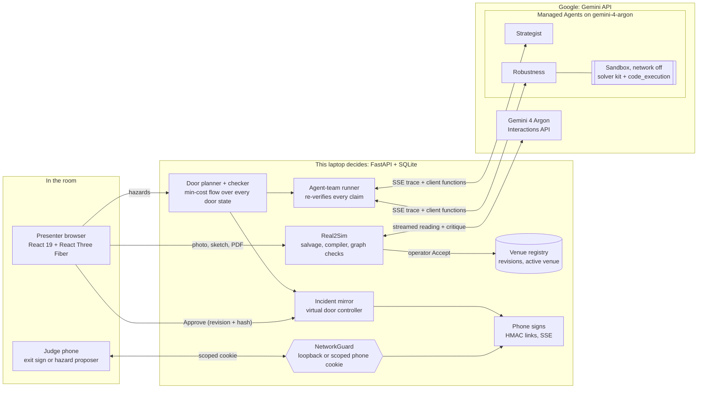
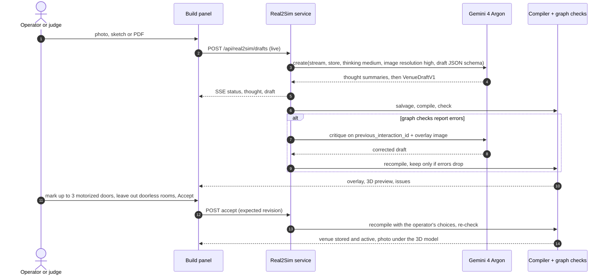
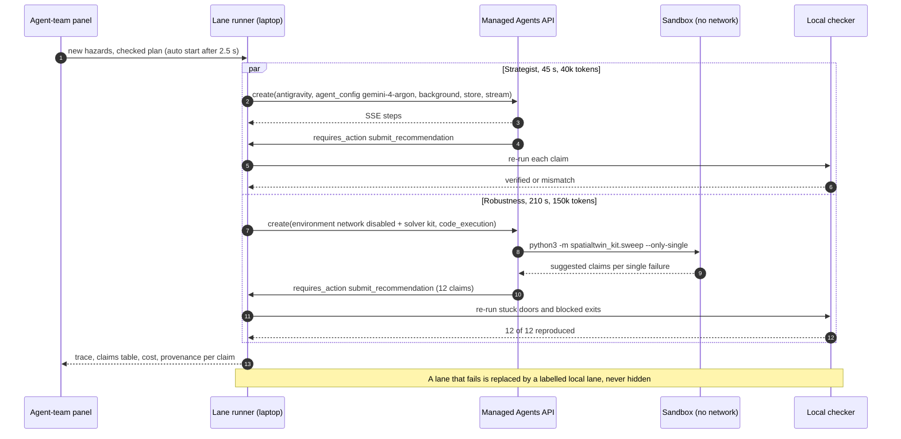
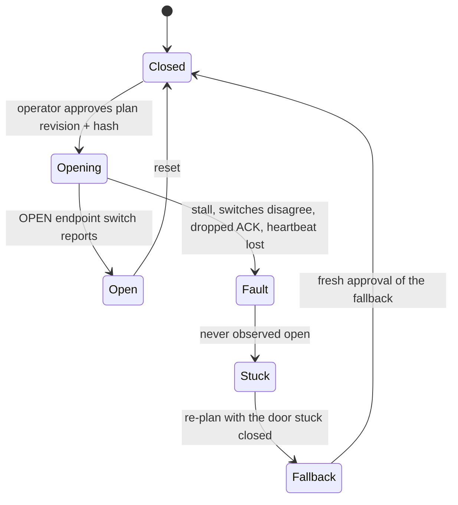

# SpatialTwin

**Photograph any building's evacuation map. Gemini 4 Argon turns it into a live 3D twin, a team of Gemini managed agents stress-tests the door plan, a local checker decides, and a person approves before any door moves.**

[](#gemini-4-argon-what-we-use-and-why)
[](#managed-agents-the-team)
[](#gemini-4-argon-what-we-use-and-why)
[](requirements.lock)
[](#provenance)
<br>
[](requirements.lock)
[](backend/app/main.py)
[](frontend/package.json)
[](frontend/src/scene)
[](#tests)
[](#doors-an-acknowledgement-is-not-arrival)

> **AI proposes · the checker decides · a human approves.** Every count is a *modeled crossing* of a synthetic population, never a survival figure. Every label says where a number came from: Live Gemini, Saved run, Local solver, Simulated device.

---

## The demo in three acts

| Act | The judge… | Under the hood | Measured live (26 Oct) |
|---|---|---|---|
| **1 · Build** | photographs the posted evacuation map (or a sketch or PDF) and presses **Accept** | Argon reads it with streamed thinking; a deterministic compiler and graph checks decide; one critique round fixes errors; the photo is laid under the 3D model | read 19–50 s, critique 35–74 s; Ferry Building maps 12 → 0 and 16 → 0 errors |
| **2 · Break it** | drops Fire, Smoke, Gas, Chemical or Water anywhere, on the laptop or from their own phone | the local planner solves and checks every state of the motorized doors in well under a second; phones become live exit signs | 0.1–0.4 s per plan |
| **3 · Agents, checker, approval** | watches two managed agents investigate, presses **Approve**, then **Jam the gate** | every number the agents claim is re-run by the checker; the virtual door must reach its endpoint; a jam forces a checked fallback that needs a fresh approval | strategist 24–38 s, robustness 57–172 s, 12/12 claims reproduced |

---

## Gemini 4 Argon: what we use and why

| Capability | How SpatialTwin uses it | Code |
|---|---|---|
| **Spatial reading of images and documents** | A photo, pen sketch or PDF becomes a `VenueDraftV1`: rooms (with kind: corridor, stair, void…), doors, exits, interior stairs, scale and "you are here", in 0–1000 `[y, x]` image coordinates | [`extract.py`](backend/app/ai/real2sim/extract.py) |
| **High-resolution image parts** | `resolution: "high"` on every image part, for the fine print of posted maps (EXIT, room numbers, scale bars) | `extract.py` |
| **Thinking with streamed summaries** | `thinking_level: "medium"`, `thinking_summaries: "auto"`, `max_output_tokens: 32768`; summaries stream into the Build panel while it reads | `extract.py` |
| **Structured output** | `response_format` with the draft's JSON schema. The API rejected the fully bounded schema ("too many states"), so it gets a structural-only copy and the laptop re-validates strictly, salvaging element by element | [`schema.py`](backend/app/ai/real2sim/schema.py) |
| **Stored, chained interactions** | `store: true`; when graph checks fail, a critique turn chains on `previous_interaction_id` and adds a second image: Argon's own reading drawn back onto the photo. The correction is kept only if the errors drop | [`critique.py`](backend/app/ai/real2sim/critique.py) |
| **Streaming (SSE)** | typed events relayed to the browser as `status · thought · draft · checks · round · done`, replayable with `Last-Event-ID` | [`drafts.py`](backend/app/ai/real2sim/drafts.py) |
| **Model identity** | the provider-echoed model must be `gemini-4-argon`; anything else discards the run (`provider_model_mismatch`). Receipts record latency and token usage, never raw content | [`receipts.py`](backend/app/ai/receipts.py) |
| **Agentic execution** | the same model drives both managed agents (`agent_config.model = "gemini-4-argon"`) | [`adapter.py`](backend/app/ai/managed/adapter.py) |

Argon never writes the venue. A **deterministic compiler** turns the draft into a strict `VenueV2` (rectilinear rooms, doors on shared walls, exits on outside walls, interior exit stairs inside their stairwell, voids excluded) and **graph checks** gate Accept: overlap, reachability, door and exit fit, `exit_overlaps_door`, capacity, horizon. If a map draws a room with no door, the operator may leave it out of the walkable floor; the venue's provenance says so.

---

## Managed Agents: the team

Two managed agents run in parallel on **`antigravity-preview-09-2026`** with an inline **`agent_config` on `gemini-4-argon`** (named agents only accept Flash models). They start by themselves 2.5 s after the planner has a checked plan for new hazards.

| Lane | Job | Tools | Budget · deadline | Live (26 Oct) |
|---|---|---|---|---|
| **Strategist** | the best door state now, and the fallback if a door jams | `submit_recommendation` | 40k tokens · 45 s | 24–38 s, 2/2 claims reproduced, ≈ $0.02 |
| **Robustness** | the plan that survives single failures | `code_execution` in a network-disabled sandbox, `verify_candidates`, `submit_recommendation` | 150k tokens · 210 s | 57–172 s, 12/12 claims reproduced (all 12 computed in the sandbox), ≈ $0.05–0.10 |
| **Follow-up** | "What if D3 jams?" in the same sandbox | same as robustness | 80k tokens · 90 s | continues on `previous_interaction_id` + the same environment |

**How they are integrated** ([`door_agent.py`](backend/app/ai/managed/door_agent.py), [`sandbox.py`](backend/app/ai/managed/sandbox.py), [`robustness.py`](backend/app/ai/managed/robustness.py))

- **Sandbox kit.** Each robustness run gets `environment: {type: remote, network: disabled, sources: inline}` carrying a 15-file, ~71 KB kit pinned by a sha256 manifest: copies of our flow solver, checker and hazard effects, a sweep, `.agents/AGENTS.md` rules and skills (`robustness-sweep`, `hazard-rules`, `responder-brief`), plus the venue, hazards and checked plan as read-only inputs.
- **Client functions, not trust.** `verify_candidates` asks the laptop's checker for numbers; `submit_recommendation` is terminal and typed: door states for every motorized door, `fallback_if_jammed`, at most 12 claims `{scenario, completed_crossings, candidate_hash}`, a 400-character rationale.
- **The checker re-runs every claim** in a scenario grammar (`stuck_closed:D3`, `exit_blocked:E2`, `jam:D2@0.50`, `untenable:h1=12`, `second_hazard:GAS@HALL`). A claim counts only if crossings and hash match and the state is checker-valid. Each claim is labelled `sandbox` only when its number appeared in that run's code output.
- **Live trace.** `background + store + stream`; `step.start / delta / stop` events (code cells, results, function calls; never hidden reasoning) flow through a trace hub to the browser over SSE with replay. A silent stream falls back to polling after 20 s; 429/503 retry with backoff inside the deadline.
- **Governance.** Per-lane deadlines, token budgets and tool-call caps; a cost estimate on screen; cancel and supersede (a new hazard set replaces the run, its local sweep stops); model echo checked; follow-ups refused if the venue geometry changed.
- **Honest fallback.** A lane that fails or times out is replaced by a labelled local lane ("Local fallback · live robustness lane failed (investigation_deadline)"), with its failure still on screen.

**Not claimed.** The sandbox has no networkx, so the kit runs its pure-Python estimator (labelled "sandbox estimate"; the exact local checker reproduced all 12 of its numbers). A pre-tool hook that denies writes is configured, but our probe never observed a denial, so no hook guardrail is claimed.

---

## Architecture



## Act 1: from a photo to a checked venue



## Act 3: two agents investigate, the checker decides



## Doors: an acknowledgement is not arrival

There is no hardware at this event. The virtual door controller keeps the hardware protocol, so the safety story is testable live.



- The chip reads **"ACK · heard, not arrived"** in transit and **"Endpoint confirmed · open"** only from the switch.
- The announcement says a door *"is to be opened"*, and *"is open"* only after its switch confirms it.
- After a jam the whole twin follows the fallback: hero ("fallback · D5 stuck · −33 vs the plan"), routes, lamps, door list, phone signs.

## Judges take part from their phones

- **A QR per exit** turns a phone into that exit's live sign: green running man, red X, locked, "no checked plan", "not updating".
- **A proposer QR** opens a floor plan: pick a hazard, tap any spot, send. With **Judge mode** on, it joins the twin at once; doors still need the operator's Approve.
- HMAC-signed links set an `HttpOnly; SameSite=Strict` cookie; the network guard lets a phone reach only its sign page and its own API, nothing of the operator's.

---

## Run it

```bash
cp .env.example .env   # then set GEMINI_API_KEY (optional: everything local works without it)
./run.sh               # sets up .venv and the frontend once, rebuilds when sources change, serves http://127.0.0.1:8000
./run.sh --lan         # also reachable by phones on the same Wi-Fi (exit signs, hazard proposals)
./run.sh --help        # --port, --build, --no-build, --setup
```

- [`.env.example`](.env.example) lists every setting: the Gemini key, Real2Sim thinking level and critique rounds, demo/production mode, phone-link secret and address.
- Without `GEMINI_API_KEY` every local path works: planner, Simulation, saved runs, local agent lanes, virtual doors. Live Argon and the live agent team need it.
- `SPATIALTWIN_SIGN_SECRET` (32+ characters) keeps phone links valid across restarts. Never point phones at `vite --host`: its proxy makes every phone look like the laptop.
- Requires Python 3.13 and Node.js; `uv` is used when present, `pip` otherwise.

Stage runbook with measured timings, judge questions and the failure plan: [`docs/demo/judge-experience.md`](docs/demo/judge-experience.md) · backup video script: [`docs/demo/backup-video.md`](docs/demo/backup-video.md).

## Tests

```bash
.venv/bin/python -m pytest -q                                  # 1197 backend tests
cd frontend && npm test && npx tsc --noEmit && npm run build   # 393 frontend tests
```

Compiler, graph checks, Real2Sim, the agent lanes, the incident controller and phone signs are all covered. The offline harness blocks provider, network and device access: every Gemini path runs against recorded stream shapes and fake clients. Live behaviour is verified separately with receipts (below).

## Verified live (25–26 October)

| What | Result |
|---|---|
| Real2Sim on the venue's own posted maps | Level 3: 12 → 0 errors, accepted · Level 2: 16 → 0, accepted · a full live run-through: 14 → 3, three doorless rooms left out, accepted |
| Full three-act run-through in the browser | fire → 71/80 "+33 by opening D5" → agents (26 s, 75 s, 12/12) → approve → endpoint → jam → fallback 38/80 |
| Agent team, five live runs | strategist always completed; robustness completed four times, once missed its old 150 s deadline (the labelled local fallback took over) |
| Capability probes | sandbox code execution with the network off · stream shape · environment reuse · networkx absent (estimator) · hook denial **not** observed |

## Safety invariants

1. **AI proposes, the checker decides.** Readings and claims are proposals; the compiler, graph checks and checker decide.
2. **No cloud tool reaches the doors.** Only the operator's Approve commands a door, keyed to the exact plan revision and candidate hash.
3. **ACK is not arrival.** A door counts as open only after its endpoint switch says so.
4. **Honest provenance.** Live Gemini, Saved run, Local solver, Simulated device are always labelled; live failures stay visible.
5. **Every occupant accounted for.** `N_initial = N_completed + N_remaining` in every frame; the checker rebuilds the network independently and rejects any plan that breaks it.

## Repository map

| Path | What |
|---|---|
| [`backend/app/ai/real2sim/`](backend/app/ai/real2sim) | Argon extraction, critique, salvage, overlays, draft service and SSE |
| [`backend/app/ai/managed/`](backend/app/ai/managed) | managed-agent lanes, trace hub, sandbox kit, robustness sweep, costs |
| [`backend/app/venues/`](backend/app/venues) | compiler, graph checks, registry, map underlay, venue routes |
| [`backend/app/hazard/`](backend/app/hazard) · [`backend/app/planner/`](backend/app/planner) | hazard effects, door planner, announcer · flow solver and checker |
| [`backend/app/incident/`](backend/app/incident) | incident mirror, virtual door controller, approvals, SSE |
| [`backend/app/signs/`](backend/app/signs) | phone sign tokens, guard allowlist, proposals, QR |
| [`frontend/src/`](frontend/src) | React app, 3D scene, Build / Simulation panels, phone sign page |
| [`docs/plans/contracts/`](docs/plans/contracts) | API contracts: Real2Sim, compiler, agent team, incident, signs |
| [`docs/research/`](docs/research) | background: the original build handoff and plans, research notes, dated status reports |

## Provenance

SpatialTwin began before the event as a physical tabletop demonstrator (servo gate, endpoint switches, overhead camera), tagged `demo-v1`. For this hackathon, with no hardware, the team built Real2Sim (Argon builds the venue), the two-lane managed-agent team, the virtual door controller, phone exit signs and Judge mode, and the 3D twin with the map underlay. The venue's evacuation-map photos stay on the presenter laptop under the owner's terms; they are not in this repository.

**Repository:** <https://github.com/charliegillet/SpatialTwin> · **Contributors:** Nihal, Charlie, Codex, Claude

**More:** [stage runbook](docs/demo/judge-experience.md) · [agent-team contract](docs/plans/contracts/agent-team.md) · [Real2Sim API](docs/plans/contracts/real2sim-api.md) · [compiler contract](docs/plans/contracts/compiler.md) · [signs contract](docs/plans/contracts/signs.md) · [managed agent guide](docs/ai/managed.md) · [grounding guide](docs/ai/grounding.md) · [interface system](DESIGN.md)
