<div align="center">

# SpatialTwin

### See the hazard. Plan the way out. Guide everyone to safety.

**Gemini 4 Argon turns a building's evacuation map today, and its live CCTV next, into a 3D twin that plans the way out.**<br>
Drop a fire anywhere: everyone is re-routed in under a second, exit signs and phones flip on their own, and Gemini managed agents stress-test the plan while a local checker re-runs every number they claim. A person approves door moves; when nobody is there to answer, an opt-in fail-safe approves the checked plan itself and never opens a door into the fire.

[](#gemini-4-argon) [](#managed-agents) [](#gemini-4-argon) [](#provenance)

[](requirements.lock) [](backend/app/main.py) [](frontend/package.json) [](frontend/src) [](frontend/src/scene) [](frontend/vite.config.ts) [](backend/app/venues/registry.py)

[](https://github.com/charliegillet/SpatialTwin/actions/workflows/ci.yml) [](#tests) [](#tests) [](#managed-agents) [](#verified-live) [](#doors-an-acknowledgement-is-not-arrival) [](#safety-invariants) [](#team)

**[The demo](#the-demo-in-three-acts)** · **[Gemini 4 Argon](#gemini-4-argon)** · **[Managed Agents](#managed-agents)** · **[Architecture](#architecture)** · **[Phones](#judges-take-part-from-their-phones)** · **[Live CCTV](#from-blueprints-to-live-cctv)** · **[No one to approve](#when-nobody-is-there-to-approve)** · **[Run it](#run-it)** · **[Team](#team)**

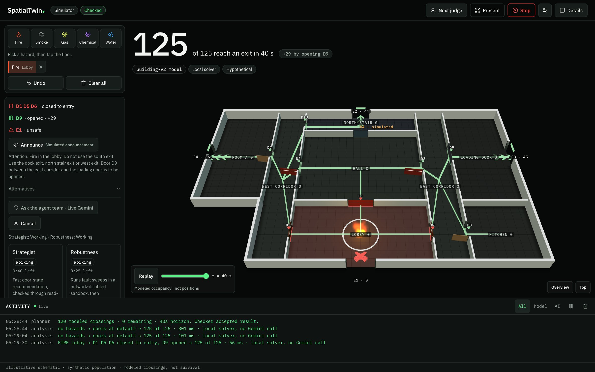

<sub>Fire in the lobby. The local planner closes three fire doors to entry, marks the south exit unsafe and opens D9 (+29 modeled crossings) in 56 ms; two live Gemini managed agents start investigating on their own.</sub>

</div>

> **AI proposes · the checker decides · a human approves.** Every count is a *modeled crossing* of a synthetic population, never a survival figure. Every number on screen says where it came from: Live Gemini, Saved run, Local solver, Simulated device.

## Why

Evacuation maps hang on every floor and nobody checks them against the room as it is today. SpatialTwin turns the posted map into a model you can break: drop a fire and see which doors to open, which exits to avoid, and whether the plan survives a jammed door, with every AI number re-checked before anyone acts on it.

For the demo it reads a photo of the posted blueprint. In a real building the same pipeline would watch the building's CCTV, place each hazard on the twin as it appears, and re-plan the evacuation live, and when nobody is there to approve, it would still steer people away from the danger. [Where this goes next ↓](#from-blueprints-to-live-cctv)

## The demo in three acts

| Act | The judge… | Under the hood | Measured live (26 Oct) |
|---|---|---|---|
| **1 · Build** | photographs the posted evacuation map (or a sketch or PDF) and presses **Accept** | Argon reads it with streamed thinking; a deterministic compiler and graph checks decide; one critique round fixes errors; the photo is laid under the 3D model | read 19–50 s, critique 35–74 s; venue maps 12 → 0 and 16 → 0 errors |
| **2 · Break it** | drops Fire, Smoke, Gas, Chemical or Water anywhere, on the laptop or from their own phone | the local planner solves and checks every state of the motorized doors; phones become live exit signs | 56–400 ms per plan |
| **3 · Agents, checker, approval** | watches two managed agents investigate, presses **Approve**, then **Jam the gate**; or arms the **fail-safe** and lets nobody answer | every number the agents claim is re-run by the checker; the virtual door must reach its endpoint; a jam forces a checked fallback that needs a fresh approval; unattended, the fail-safe approves after holding shut every door into the fire | strategist 24–38 s, robustness 57 s – 2 min 52 s, 14/14 claims reproduced |

<table>
  <tr>
    <td width="50%">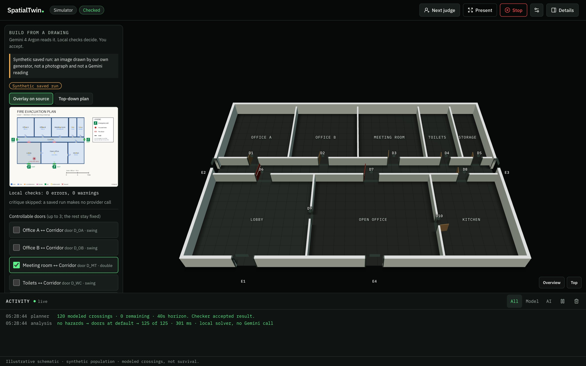<br><sub><b>Act 1 · Build.</b> Argon's reading drawn back onto the map, checks at 0 errors, the 3D draft before Accept. (Our synthetic test map.)</sub></td>
    <td width="50%">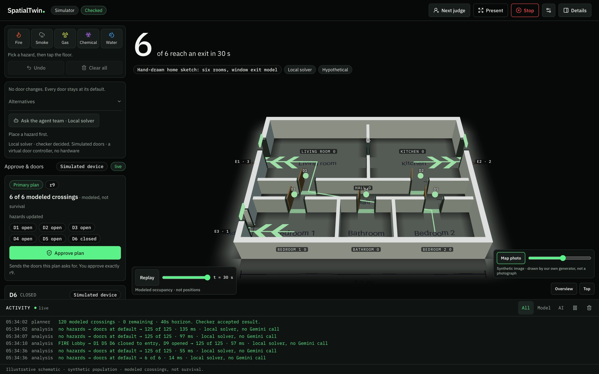<br><sub><b>The map under the model.</b> The source image aligned under the 3D walls through the compiler's own frame, with a toggle and opacity slider.</sub></td>
  </tr>
  <tr>
    <td width="50%">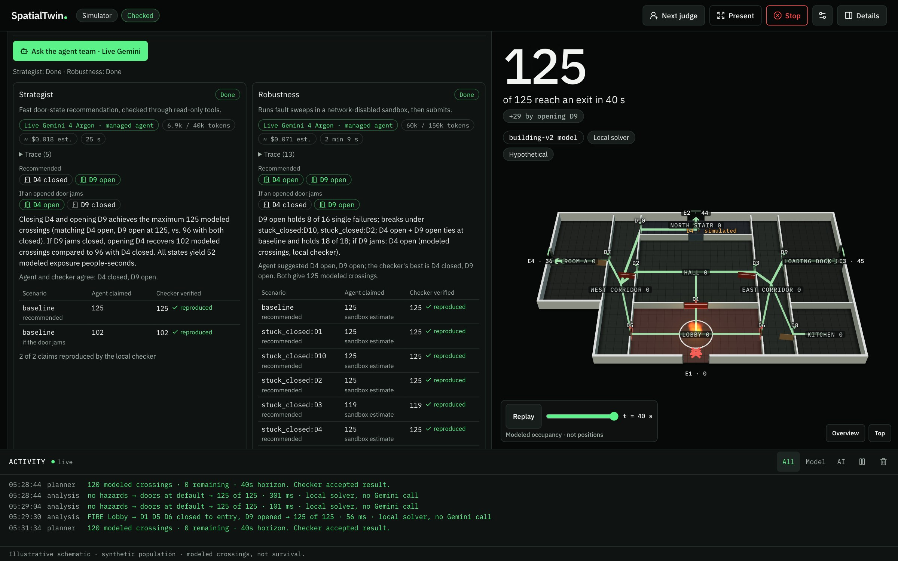<br><sub><b>Act 3 · Two live managed agents.</b> Strategist 25 s, robustness 2 min 9 s; every claimed number re-run by the checker, 14 of 14 reproduced.</sub></td>
    <td width="50%">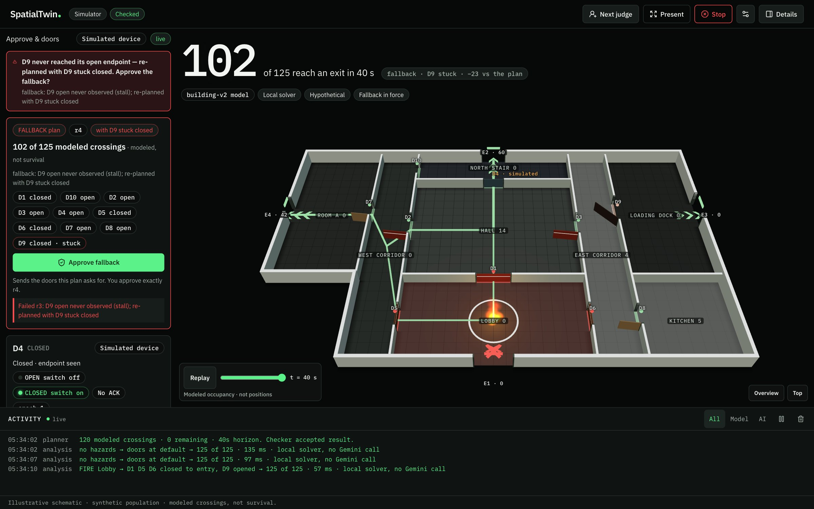<br><sub><b>Jam the gate.</b> D9 never reached its endpoint: the whole twin follows the checked fallback (102 of 125, "D9 stuck · −23"), which needs a fresh approval.</sub></td>
  </tr>
</table>

---

## Gemini 4 Argon

Argon is the eyes of the system: it reads a building from a photo and proposes its geometry. It never writes the venue; a deterministic compiler and graph checks do.

| Capability | How SpatialTwin uses it | Code |
|---|---|---|
| **Spatial reading of images and documents** | A photo, pen sketch or PDF becomes a `VenueDraftV1`: rooms with their kind (corridor, stair, void…), doors, exits, interior stairs, scale and "you are here", in 0–1000 `[y, x]` image coordinates | [`extract.py`](backend/app/ai/real2sim/extract.py) |
| **High-resolution image parts** | `resolution: "high"` on every image part, for the fine print of posted maps (EXIT, room numbers, scale bars) | `extract.py` |
| **Thinking with streamed summaries** | `thinking_level: "medium"`, `thinking_summaries: "auto"`, `max_output_tokens: 32768`; summaries stream into the Build panel while it reads | `extract.py` |
| **Structured output** | `response_format` with the draft's JSON schema. The API rejected the fully bounded schema ("too many states"), so it gets a structural-only copy and the laptop re-validates strictly, salvaging element by element | [`schema.py`](backend/app/ai/real2sim/schema.py) |
| **Stored, chained interactions** | `store: true`; when checks fail, a critique turn chains on `previous_interaction_id` and adds a second image, Argon's own reading drawn back onto the photo. The correction is kept only if the errors drop | [`critique.py`](backend/app/ai/real2sim/critique.py) |
| **Streaming (SSE)** | typed events relayed to the browser (`status · thought · draft · checks · round · done`), replayable with `Last-Event-ID` | [`drafts.py`](backend/app/ai/real2sim/drafts.py) |
| **Model identity** | the provider-echoed model must be `gemini-4-argon`, or the run is discarded (`provider_model_mismatch`). Receipts keep latency and token usage, never content | [`receipts.py`](backend/app/ai/receipts.py) |
| **Agentic execution** | the same model drives both managed agents (`agent_config.model = "gemini-4-argon"`) | [`adapter.py`](backend/app/ai/managed/adapter.py) |

**What happens to Argon's reading.** The compiler builds a strict `VenueV2`: rectilinear rooms, doors on shared walls, exits on outside walls, interior exit stairs inside their stairwell, voids excluded. Graph checks gate Accept (overlap, reachability, door and exit fit, `exit_overlaps_door`, capacity, horizon). If a map draws a room with no door, the operator can leave it out of the walkable floor, and the venue's provenance says so.

---

## Managed Agents

Two managed agents run in parallel on **`antigravity-preview-09-2026`** with an inline **`agent_config` on `gemini-4-argon`** (named agents only accept Flash models). They start by themselves 2.5 s after the planner has a checked plan for new hazards; a newer hazard set supersedes them.

| Lane | Job | Tools | Budget · deadline | Live (26 Oct) |
|---|---|---|---|---|
| **Strategist** | the best door state now, and the fallback if a door jams | `submit_recommendation` | 40k tokens · 45 s | 24–38 s · 2/2 claims reproduced · ≈ $0.02 |
| **Robustness** | the plan that survives single failures | `code_execution` in a network-disabled sandbox, `verify_candidates`, `submit_recommendation` | 150k tokens · 210 s | 57 s – 2 min 52 s · 12/12 reproduced, all computed in the sandbox · ≈ $0.05–0.10 |
| **Follow-up** | "What if D3 jams?" in the same sandbox | same as robustness | 80k tokens · 90 s | continues on `previous_interaction_id` and the same environment |

<p align="center">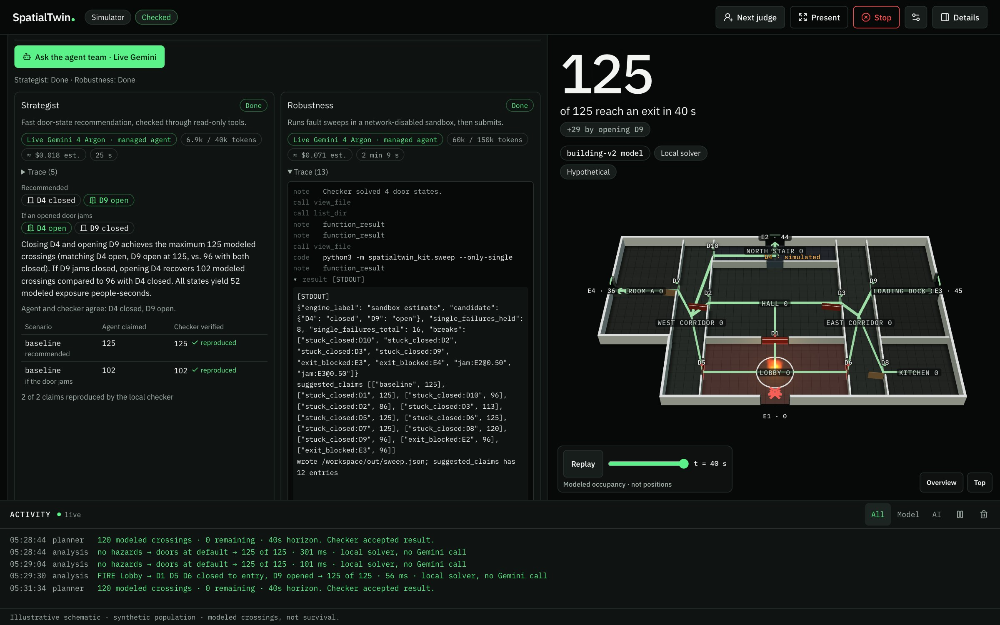<br><sub>The robustness lane's live trace: the agent runs our solver kit in Google's network-disabled sandbox (<code>code_execution</code>) and its own stdout becomes the claims the checker then re-runs.</sub></p>

**How they are integrated** ([`door_agent.py`](backend/app/ai/managed/door_agent.py) · [`sandbox.py`](backend/app/ai/managed/sandbox.py) · [`robustness.py`](backend/app/ai/managed/robustness.py) · [`trace.py`](backend/app/ai/managed/trace.py))

- **Sandbox kit.** Each robustness run gets `environment: {type: remote, network: disabled, sources: inline}` carrying a 15-file, ~71 KB kit pinned by a sha256 manifest: copies of our flow solver, checker and hazard effects, a sweep, `.agents/AGENTS.md` rules and skills (`robustness-sweep`, `hazard-rules`, `responder-brief`), plus the venue, hazards and checked plan as read-only inputs.
- **Client functions, not trust.** `verify_candidates` asks the laptop's checker for numbers; `submit_recommendation` is terminal and typed: door states for every motorized door, `fallback_if_jammed`, at most 12 claims `{scenario, completed_crossings, candidate_hash}`, a 400-character rationale.
- **The checker re-runs every claim** in a scenario grammar (`stuck_closed:D3`, `exit_blocked:E2`, `jam:D2@0.50`, `untenable:h1=12`, `second_hazard:GAS@HALL`). A claim counts only if crossings and hash match and the state is checker-valid; it is labelled `sandbox` only when its number appeared in that run's code output.
- **Live trace.** `background + store + stream`: `step.start / delta / stop` events (code cells, results, function calls; never hidden reasoning) flow through a trace hub to the browser over SSE with replay. A silent stream falls back to polling after 20 s; 429/503 retry with backoff inside the deadline.
- **Governance.** Per-lane deadlines, token budgets and tool-call caps; a cost estimate on screen; cancel and supersede (the local sweep stops too); the echoed model is checked; follow-ups are refused if the venue geometry changed.
- **Honest fallback.** A lane that fails or times out is replaced by a labelled local lane ("Local fallback · live robustness lane failed (investigation_deadline)"), with its failure still on screen.

> **Not claimed.** The sandbox has no networkx, so the kit runs its pure-Python estimator, labelled "sandbox estimate"; the exact local checker reproduced every one of its numbers. A pre-tool hook that denies writes is configured, but our probe never observed a denial, so no hook guardrail is claimed.

---

## Architecture

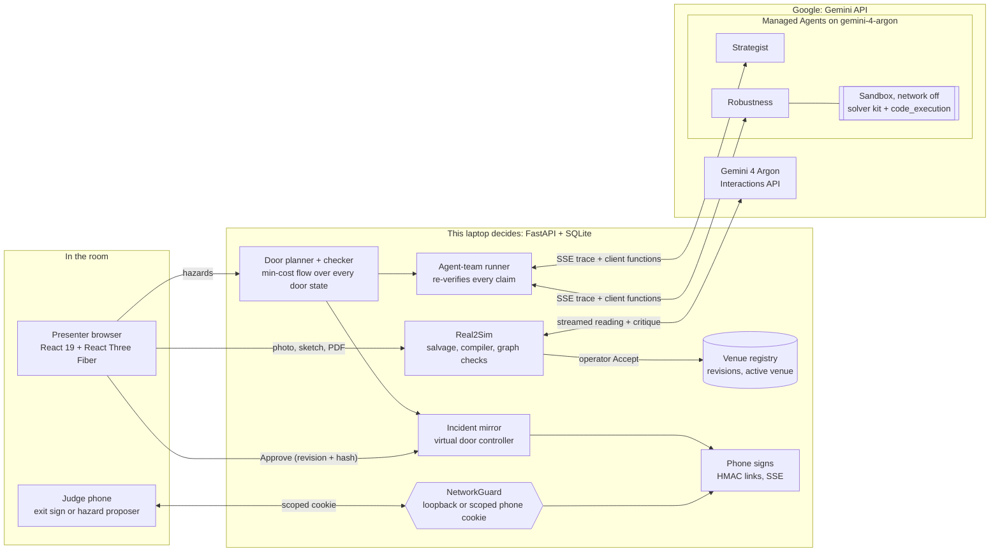

<details>
<summary><b>Act 1 in detail: from a photo to a checked venue</b> (sequence diagram)</summary>

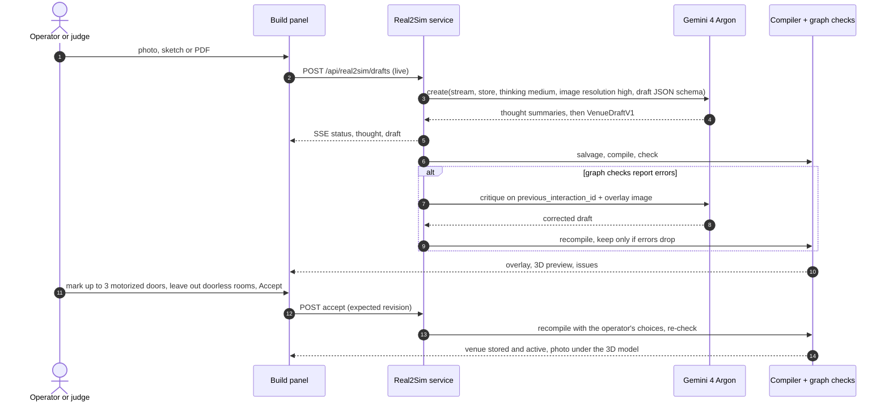

</details>

<details>
<summary><b>Act 3 in detail: two agents investigate, the checker decides</b> (sequence diagram)</summary>

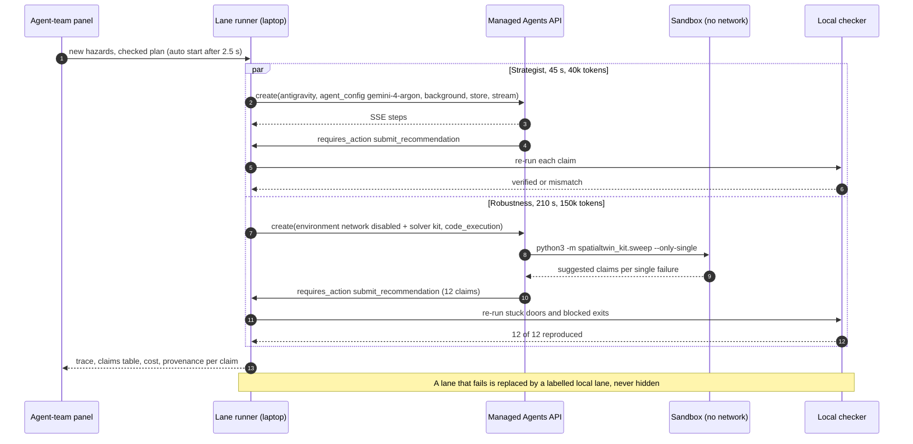

</details>

## Doors: an acknowledgement is not arrival

There is no hardware at this event. The virtual door controller keeps the hardware protocol, so the safety story is testable live.

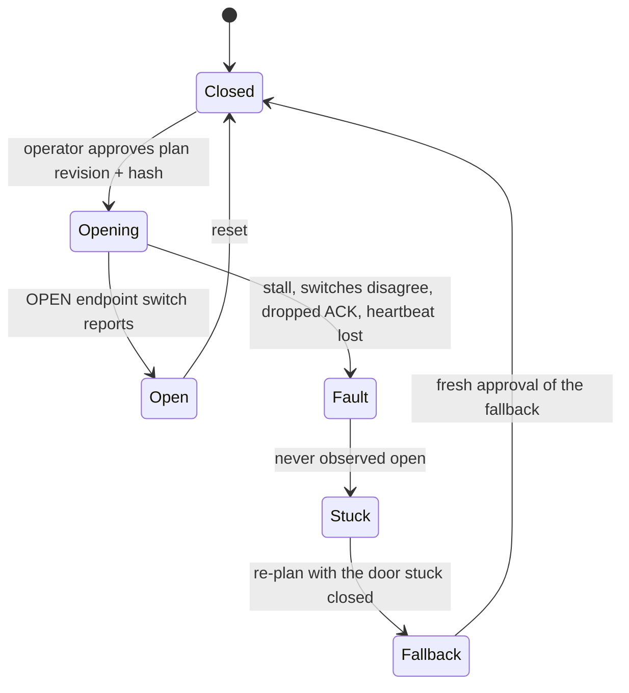

- In transit the chip reads **"ACK · heard, not arrived"**; only the switch makes it **"Endpoint confirmed · open"**.
- The announcement says a door *"is to be opened"*, and *"is open"* only after its switch confirms it.
- After a jam the whole twin follows the fallback: hero, routes, lamps, door list and phone signs.

## Judges take part from their phones

<p align="center">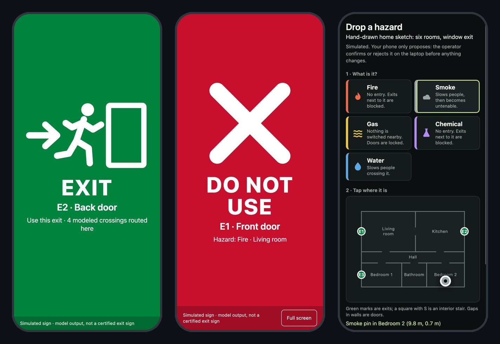</p>

- **A QR per exit** turns a phone into that exit's live sign: green running man with the modeled crossings routed there, red X with the hazard, locked, "no checked plan", "not updating".
- **A proposer QR** opens a floor plan: pick a hazard, tap any spot, send. With **Judge mode** on, it joins the twin at once; doors still need the operator's Approve.
- HMAC-signed links set an `HttpOnly; SameSite=Strict` cookie; the network guard lets a phone reach only its sign page and its own API, nothing of the operator's.

---

## From blueprints to live CCTV

The demo builds the building from a photo of its posted evacuation plan, and judges drop the hazards. A real building already has eyes: its CCTV. The same pipeline reads those feeds, places each hazard on the twin where a camera sees it, and re-plans the evacuation as the scene changes.

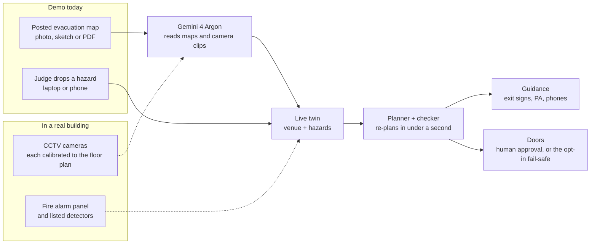

<sub>Solid arrows are built and demoed; dashed arrows are the next step.</sub>

| | Demo today | In a real building |
|---|---|---|
| **The floor plan** | a photo of the posted map, read live by Argon | the same, once per floor, re-read when the layout changes |
| **Hazards** | dropped by the judge on the laptop or a phone | seen by CCTV, confirmed by the fire panel and listed detectors |
| **How Argon sees** | one image per reading, with streamed thinking | short clips from each camera with **agentic video understanding** (Argon takes video input; it has no Live API, so cameras are sampled, not streamed) |
| **Camera to floor plan** | built: the camera mode maps an overhead camera onto the plan through a four-point homography ([`calibration.py`](backend/app/ai/grounding/calibration.py)), verified on synthetic stills | one calibration per CCTV camera, so a fire seen in a frame lands in the right room of the twin |
| **Who confirms a hazard** | the operator (camera reads are proposals, [`camera.py`](backend/app/venues/camera.py)) | the operator or the fire panel; when nobody answers, the fail-safe below acts on the checked plan |
| **Where guidance goes** | the 3D twin, phone signs, the announcement | the building's dynamic exit signs, PA and phones |

Video fire and smoke detection is a recognized technology: NFPA 72 covers flame and smoke video image detection as listed, performance-based systems ([SFPE](https://www.sfpe.org/FPEETIssue21)). SpatialTwin is meant to sit behind such detectors, adding the part they lack: where each hazard is in the building, and which way everyone should go now.

## When nobody is there to approve

If you are caught near a fire, you cannot wait for an operator who is not there. SpatialTwin acts on its own wherever acting is safe, and its opt-in fail-safe covers exactly that moment.

| Level | What SpatialTwin does | Status |
|---|---|---|
| **Advise** | the checked plan, routes, the announcement text, the agents' analysis | built |
| **Guide** | the moment a hazard is confirmed, 3D exit signs and phone signs flip to a red X near the danger and a green arrow toward the checked safe exits, with no approval needed: guidance never moves a door | built |
| **Recover** | a jammed door or a lost controller heartbeat triggers an automatic re-plan around the failure | built |
| **Act with approval** | motorized doors move only on the operator's Approve, keyed to the exact plan; a door counts as open only when its switch says so | built |
| **Act alone, fail-safe** | armed from the Approve panel, every new checked plan gets a window (10–60 s). If nobody approves, the fail-safe approves the plan itself, with two rules a person does not need: it **never opens a motorized door into a room with fire, smoke, gas or a chemical** (those doors are held shut and the plan is re-checked without them; if that re-check fails, nothing moves) and it treats any door in doubt as stuck closed. It says so aloud, logs every step, re-plans after a jam with a fresh window, and **I'm here** hands control back with the full plan | **built, opt-in** ([`failsafe.py`](backend/app/incident/failsafe.py)) |
| **Act alone, from cameras** | hazards seen by CCTV and the fire panel feed the same fail-safe, and the PA speaks its plan | next |

Measured on the built-in building: a fire in the hall. The planner's best plan opens D4 from the burning hall into the north stair (105 of 125 modeled crossings). Unattended, the fail-safe keeps D4 shut and approves the re-checked plan: 93 of 125, and the panel says "a person could approve 105 by opening D4". A person can do better; without one, it still acts, keeps every door into the fire shut, and says what that costs.

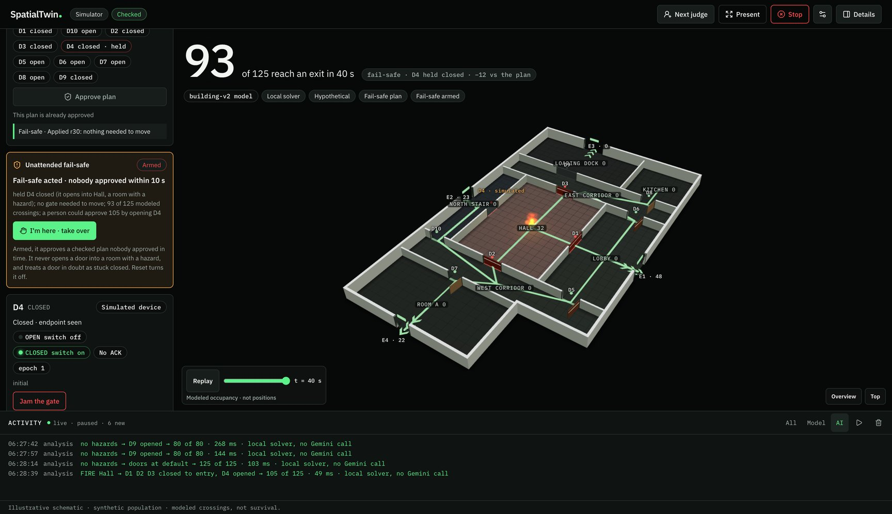

<sub>Fire in the hall, nobody at the screen. After 10 s the fail-safe holds D4 shut (it opens into the fire), approves the re-checked plan and says what a person could approve instead. <b>I'm here · take over</b> hands the full plan back.</sub>

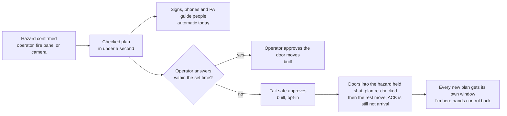

This is the principle buildings already rely on. Fire doors held open on magnetic releases close automatically when the alarm sounds, with no person involved ([NFPA 80 FAQ](https://www.nfpa.org/news-blogs-and-articles/blogs/2025/04/11/fire-doors-faqs)). And adaptive exit signs that warn people off a dangerous exit need a central system choosing routes in real time ([NFPA Research Foundation review](https://www.nfpa.org/education-and-research/research/fire-protection-research-foundation/projects-and-reports/a-review-of-dynamic-directional-exit-signage-challenges-and-perspectives); see also [Evaclite](https://evaclite.com/)). SpatialTwin aims to be that system, with one rule kept: no sign changes and no door moves on a route the checker has not verified.

---

## Run it

```bash
cp .env.example .env   # then set GEMINI_API_KEY (optional: everything local works without it)
./run.sh               # sets up .venv and the frontend once, rebuilds when sources change, serves http://127.0.0.1:8000
./run.sh --lan         # also reachable by phones on the same Wi-Fi (exit signs, hazard proposals)
./run.sh --help        # --port, --build, --no-build, --setup
```

- [`.env.example`](.env.example) lists every setting: the Gemini key, Real2Sim thinking level and critique rounds, demo or production mode, phone-link secret and address.
- Without `GEMINI_API_KEY` every local path works: planner, Simulation, saved runs, local agent lanes, virtual doors. Live Argon and the live agent team need it.
- `SPATIALTWIN_SIGN_SECRET` (32+ characters) keeps phone links valid across restarts. Never point phones at `vite --host`: its proxy makes every phone look like the laptop.
- Requires Python 3.13 and Node.js; `uv` is used when present, `pip` otherwise.

Stage runbook with measured timings, judge questions and the failure plan: [`docs/demo/judge-experience.md`](docs/demo/judge-experience.md) · backup video script: [`docs/demo/backup-video.md`](docs/demo/backup-video.md).

## Tests

```bash
.venv/bin/python -m pytest -q                                  # 1214 backend tests
cd frontend && npm test && npx tsc --noEmit && npm run build   # 403 frontend tests
```

Compiler, graph checks, Real2Sim, the agent lanes, the incident controller, the fail-safe and phone signs are all covered, and [CI](.github/workflows/ci.yml) runs both suites on every push to `main`. `tools/smoke_connections.py --base http://127.0.0.1:8000` drives a running server end to end (53 checks, no Gemini calls; it resets the shared incident, so not mid-demo). The offline harness blocks provider, network and device access: every Gemini path runs against recorded stream shapes and fake clients. Live behaviour is verified separately with receipts (below).

## Verified live

| What | Result |
|---|---|
| Real2Sim on the venue's own posted maps (25–26 Oct) | Level 3: 12 → 0 errors, accepted · Level 2: 16 → 0, accepted · a full live run-through: 14 → 3, three doorless rooms left out, accepted |
| Full three-act run-through in the browser | fire → 71/80 "+33 by opening D5" → agents (26 s, 75 s, 12/12) → approve → endpoint → jam → fallback 38/80 |
| Agent team, six live runs | strategist always completed (24–38 s); robustness completed five times (57 s – 2 min 52 s), once missed its old 150 s deadline and the labelled local fallback took over |
| Capability probes | sandbox code execution with the network off · stream shape · environment reuse · networkx absent (estimator) · hook denial **not** observed |

## Safety invariants

1. **AI proposes, the checker decides.** Readings and claims are proposals; the compiler, graph checks and checker decide.
2. **No cloud tool reaches the doors.** Only an approval commands a door, keyed to the exact plan revision and candidate hash: the operator's, or, when armed and nobody answered in time, the [fail-safe's](#when-nobody-is-there-to-approve), which approves only a checked plan and never opens a motorized door into a room with a hazard.
3. **ACK is not arrival.** A door counts as open only after its endpoint switch says so.
4. **Honest provenance.** Live Gemini, Saved run, Local solver, Simulated device are always labelled; live failures stay visible.
5. **Every occupant accounted for.** `N_initial = N_completed + N_remaining` in every frame; the checker rebuilds the network independently and rejects any plan that breaks it.

<details>
<summary><b>Repository map</b></summary>

| Path | What |
|---|---|
| [`backend/app/ai/real2sim/`](backend/app/ai/real2sim) | Argon extraction, critique, salvage, overlays, draft service and SSE |
| [`backend/app/ai/managed/`](backend/app/ai/managed) | managed-agent lanes, trace hub, sandbox kit, robustness sweep, costs |
| [`backend/app/venues/`](backend/app/venues) | compiler, graph checks, registry, map underlay, venue routes |
| [`backend/app/hazard/`](backend/app/hazard) · [`backend/app/planner/`](backend/app/planner) | hazard effects, door planner, announcer · flow solver and checker |
| [`backend/app/incident/`](backend/app/incident) | incident mirror, virtual door controller, approvals, SSE |
| [`backend/app/signs/`](backend/app/signs) | phone sign tokens, guard allowlist, proposals, QR |
| [`frontend/src/`](frontend/src) | React app, 3D scene, Build / Simulation panels, phone sign page |
| [`docs/plans/contracts/`](docs/plans/contracts) | API contracts: Real2Sim, compiler, agent team, incident, signs |
| [`docs/research/`](docs/research) | background: the original build handoff and plans, research notes, dated status reports |

</details>

## Provenance

SpatialTwin began before the event as a physical tabletop demonstrator (servo gate, endpoint switches, overhead camera), tagged `demo-v1`. For this hackathon, with no hardware, the team built Real2Sim (Argon builds the venue), the two-lane managed-agent team, the virtual door controller, phone exit signs and Judge mode, and the 3D twin with the map underlay. The venue's evacuation-map photos stay on the presenter laptop under the owner's terms: they are not in this repository, and every screenshot here uses the built-in building or our own synthetic maps.

## Team

Built by **Charlie** and **Yahya**, with a lot of help from AI coding agents. Claude Code ran as a team lead with Opus and Sonnet teammates and an independent devil's-advocate reviewer, and Codex built the original core. The agents wrote, tested and reviewed much of the code; the humans set the direction, checked the results and made the calls.

**Repository:** <https://github.com/charliegillet/SpatialTwin>

**More:** [stage runbook](docs/demo/judge-experience.md) · [agent-team contract](docs/plans/contracts/agent-team.md) · [Real2Sim API](docs/plans/contracts/real2sim-api.md) · [compiler contract](docs/plans/contracts/compiler.md) · [signs contract](docs/plans/contracts/signs.md) · [managed agent guide](docs/ai/managed.md) · [grounding guide](docs/ai/grounding.md) · [interface system](DESIGN.md)
